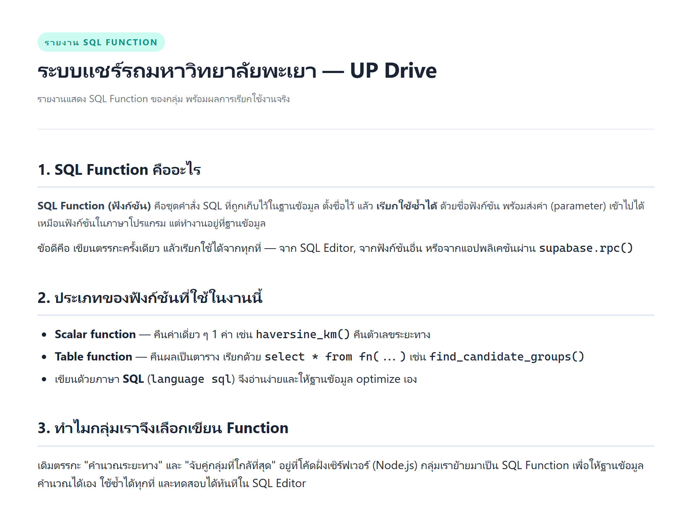
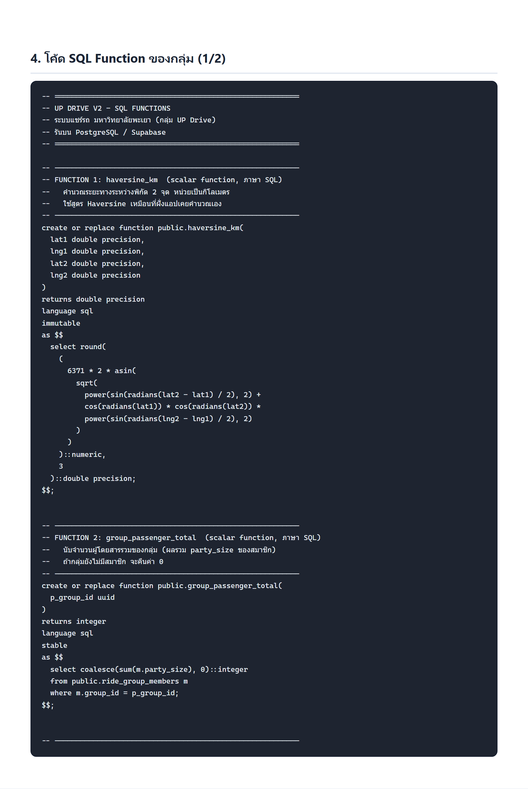
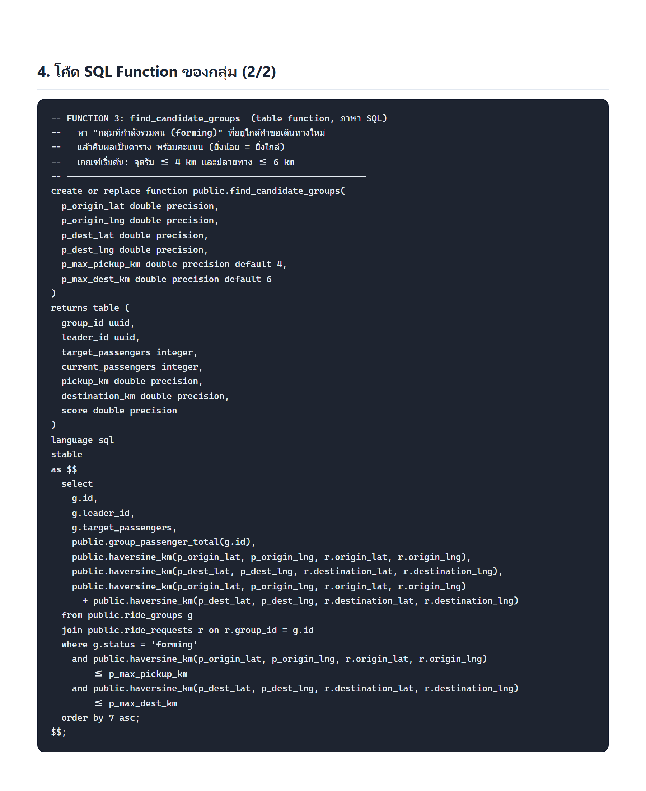
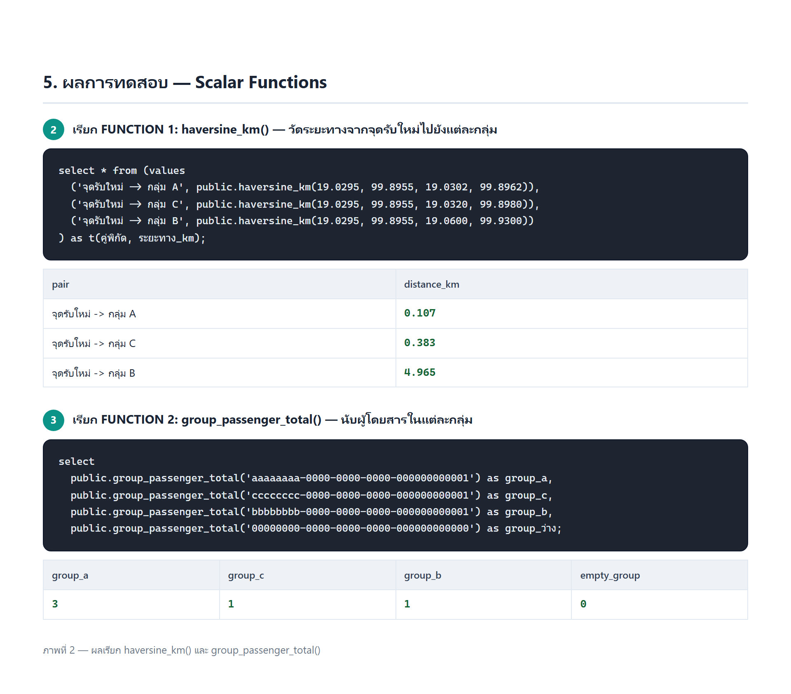
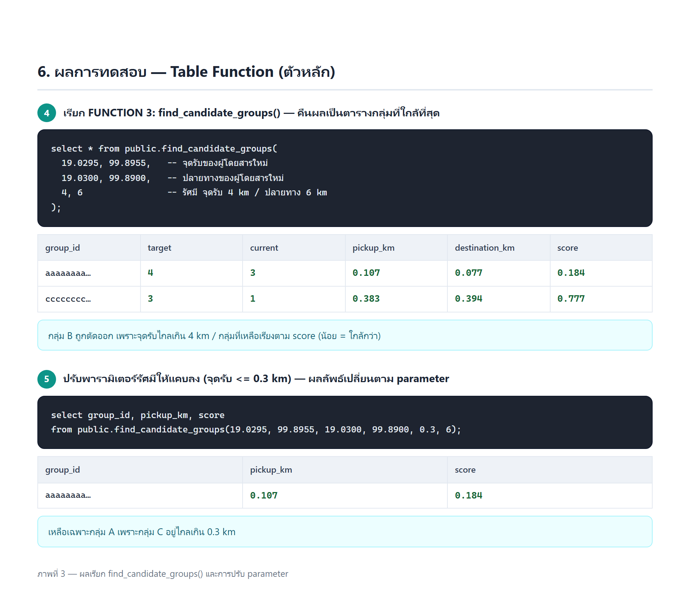
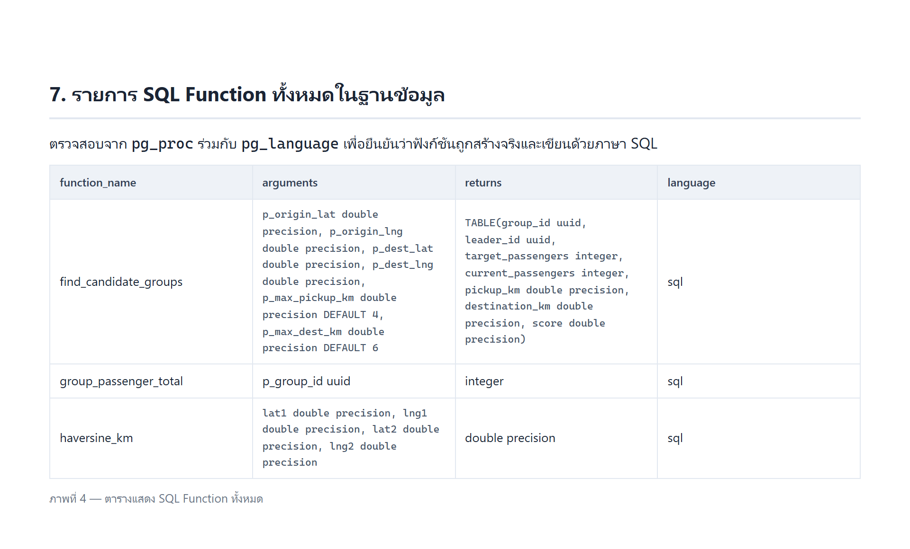

# รายงาน SQL Function — กลุ่ม UP Drive

**โครงงาน:** ระบบแชร์ค่ารถสำหรับนักศึกษา มหาวิทยาลัยพะเยา (UP Drive)
**ฐานข้อมูล:** PostgreSQL ผ่าน Supabase
**หัวข้อรายงาน:** SQL Function ของกลุ่ม
**สมาชิกในกลุ่ม:** _______________________

---



> รูปในรายงานนี้เป็น **ผลการเรียกใช้ฟังก์ชันจริง** บน PostgreSQL 16
> (จำลองด้วย PGlite/WASM) ด้วย SQL ชุดเดียวกับที่ใช้บน Supabase
> ไฟล์ SQL ทั้งหมดอยู่ในโฟลเดอร์นี้ (`functions.sql`, `test-function.sql`)

---

## 1. SQL Function คืออะไร

**SQL Function (ฟังก์ชัน)** คือชุดคำสั่ง SQL ที่ถูกเก็บไว้ในฐานข้อมูล ตั้งชื่อไว้ แล้ว
**เรียกใช้ซ้ำได้** ด้วยชื่อฟังก์ชัน พร้อมส่งค่า (parameter) เข้าไปได้ เหมือนฟังก์ชันในภาษาโปรแกรม
แต่ทำงานอยู่ที่ฐานข้อมูล

ข้อดีคือ เขียนตรรกะครั้งเดียว แล้วเรียกใช้ได้จากทุกที่ — จาก SQL Editor, จากฟังก์ชันอื่น
หรือจากแอปพลิเคชันผ่าน `supabase.rpc()`

## 2. ประเภทของฟังก์ชันที่ใช้ในงานนี้

| ประเภท | ลักษณะ | ตัวอย่างในงานนี้ |
| --- | --- | --- |
| **Scalar function** | คืนค่าเดี่ยว 1 ค่า | `haversine_km()` คืนตัวเลขระยะทาง |
| **Table function** | คืนผลเป็นตาราง เรียกด้วย `select * from fn(...)` | `find_candidate_groups()` |
| **ภาษา SQL** | เขียนด้วย `language sql` อ่านง่าย ให้ฐานข้อมูล optimize เอง | ทั้ง 3 ฟังก์ชัน |

## 3. เหตุผลที่กลุ่มเลือกเขียน Function

เดิมตรรกะ "คำนวณระยะทาง" และ "จับคู่กลุ่มที่ใกล้ที่สุด" อยู่ที่โค้ดฝั่งเซิร์ฟเวอร์ (Node.js)
กลุ่มเราย้ายมาเป็น SQL Function เพื่อให้ฐานข้อมูลคำนวณได้เอง ใช้ซ้ำได้ทุกที่
และทดสอบได้ทันทีใน SQL Editor

---

## 4. SQL Function ทั้ง 3 ตัวของกลุ่ม





| # | ชื่อฟังก์ชัน | ประเภท | หน้าที่ |
| --- | --- | --- | --- |
| 1 | `haversine_km(lat1,lng1,lat2,lng2)` | scalar | คำนวณระยะทางระหว่างพิกัด 2 จุด (km) ด้วยสูตร Haversine |
| 2 | `group_passenger_total(group_id)` | scalar | นับจำนวนผู้โดยสารรวมของกลุ่ม (ผลรวม `party_size`) |
| 3 | `find_candidate_groups(...)` | table | หากลุ่มที่กำลังรวมคนซึ่งใกล้คำขอใหม่ คืนเป็นตารางพร้อมคะแนน |

โค้ดเต็มอยู่ในไฟล์ [`functions.sql`](functions.sql) — สรุป FUNCTION 3 (ตัวหลัก):

```sql
create or replace function public.find_candidate_groups(
  p_origin_lat double precision, p_origin_lng double precision,
  p_dest_lat double precision,   p_dest_lng double precision,
  p_max_pickup_km double precision default 4,
  p_max_dest_km   double precision default 6
)
returns table (
  group_id uuid, leader_id uuid, target_passengers integer,
  current_passengers integer, pickup_km double precision,
  destination_km double precision, score double precision
)
language sql stable
as $$
  select g.id, g.leader_id, g.target_passengers,
    public.group_passenger_total(g.id),
    public.haversine_km(p_origin_lat, p_origin_lng, r.origin_lat, r.origin_lng),
    public.haversine_km(p_dest_lat, p_dest_lng, r.destination_lat, r.destination_lng),
    public.haversine_km(p_origin_lat, p_origin_lng, r.origin_lat, r.origin_lng)
      + public.haversine_km(p_dest_lat, p_dest_lng, r.destination_lat, r.destination_lng)
  from public.ride_groups g
  join public.ride_requests r on r.group_id = g.id
  where g.status = 'forming'
    and public.haversine_km(p_origin_lat, p_origin_lng, r.origin_lat, r.origin_lng) <= p_max_pickup_km
    and public.haversine_km(p_dest_lat, p_dest_lng, r.destination_lat, r.destination_lng) <= p_max_dest_km
  order by 7 asc;
$$;
```

---

## 5. ผลการทดสอบ — Scalar Functions



**haversine_km()** — วัดระยะทางจากจุดรับของผู้โดยสารใหม่ไปยังแต่ละกลุ่ม

| คู่พิกัด | ระยะทาง (km) | หมายเหตุ |
| --- | --- | --- |
| จุดรับใหม่ → กลุ่ม A | 0.107 | ใกล้มาก |
| จุดรับใหม่ → กลุ่ม C | 0.383 | ใกล้ |
| จุดรับใหม่ → กลุ่ม B | 4.965 | ไกลเกิน 4 km |

**group_passenger_total()** — นับผู้โดยสารรวมของแต่ละกลุ่ม

| group_a | group_c | group_b | กลุ่มที่ไม่มีอยู่ |
| --- | --- | --- | --- |
| 3 | 1 | 1 | 0 |

> กลุ่ม A มีสมาชิก 1 คนที่มาเป็นหมู่คณะ (party_size = 3) ฟังก์ชันจึงคืน 3

---

## 6. ผลการทดสอบ — Table Function (ตัวหลัก)



เรียก `find_candidate_groups(19.0295, 99.8955, 19.0300, 99.8900, 4, 6)`:

| group_id | target | current | pickup_km | destination_km | score |
| --- | --- | --- | --- | --- | --- |
| aaaaaaaa | 4 | 3 | 0.107 | 0.077 | 0.184 |
| cccccccc | 3 | 1 | 0.383 | 0.394 | 0.777 |

- กลุ่ม B **ถูกตัดออก** เพราะจุดรับไกลเกิน 4 km
- ผลลัพธ์ **เรียงตาม score** (น้อย = ใกล้กว่า)

เมื่อปรับรัศมีให้แคบลงเป็น `0.3` km เหลือเฉพาะกลุ่ม A — ยืนยันว่าฟังก์ชันรับ parameter ได้จริง

---

## 7. รายการ SQL Function ทั้งหมดในฐานข้อมูล

ตรวจสอบจาก `pg_proc` ร่วมกับ `pg_language`



---

## 8. วิธีทดสอบซ้ำใน Supabase (ทำเองเพื่อเก็บภาพหน้าจอ)

1. เปิด **Supabase → SQL Editor** ของโปรเจกต์
2. เปิดไฟล์ [`test-function.sql`](test-function.sql) คัดลอกทั้งไฟล์วางแล้วกด **Run**
3. สคริปต์จะสร้างฟังก์ชัน แล้วรันทดสอบทีละข้อ (มีคำสั่ง `select` คั่นให้เห็นผลแต่ละข้อ)
4. **แคปหน้าจอ** ผลลัพธ์ในแต่ละข้อ
5. เรียกจากแอปได้ด้วย `supabase.rpc('haversine_km', { lat1, lng1, lat2, lng2 })`

---

## 9. สรุป

- กลุ่มเราเพิ่ม **SQL Function จำนวน 3 ตัว** (2 scalar + 1 table function) เขียนด้วยภาษา SQL
- `haversine_km()` คำนวณระยะทางจริงได้ถูกต้อง — ทดสอบให้ผล 0.107 / 0.383 / 4.965 km ตรงตามพิกัด
- `group_passenger_total()` นับผู้โดยสารรวมของกลุ่มได้ถูกต้อง และคืน 0 เมื่อกลุ่มว่าง
- `find_candidate_groups()` คืนกลุ่มที่ใกล้ที่สุดพร้อมคะแนน และกรองกลุ่มที่ไกลเกินระยะได้จริง

### ไฟล์ประกอบในโฟลเดอร์นี้

| ไฟล์ | รายละเอียด |
| --- | --- |
| `report.docx` | **ไฟล์ Word พร้อมรูป — อัปโหลดเข้า Google Drive แล้วเปิดเป็น Google Doc ได้เลย** |
| `report.md` | รายงานฉบับนี้ (Markdown) |
| `report.html` | รายงานฉบับเต็มสำหรับเปิดอ่าน/พิมพ์ |
| `functions.sql` | โค้ด SQL Function ทั้ง 3 ตัว |
| `test-function.sql` | สคริปต์ทดสอบสำหรับรันใน Supabase SQL Editor |
| `screenshots/` | ภาพประกอบทั้ง 6 ภาพ |
| `fig*.html` | หน้าเว็บต้นทางของแต่ละภาพ |
| `demo/` | สคริปต์ที่ใช้รันทดสอบจริงและสร้างภาพ (PGlite) |
