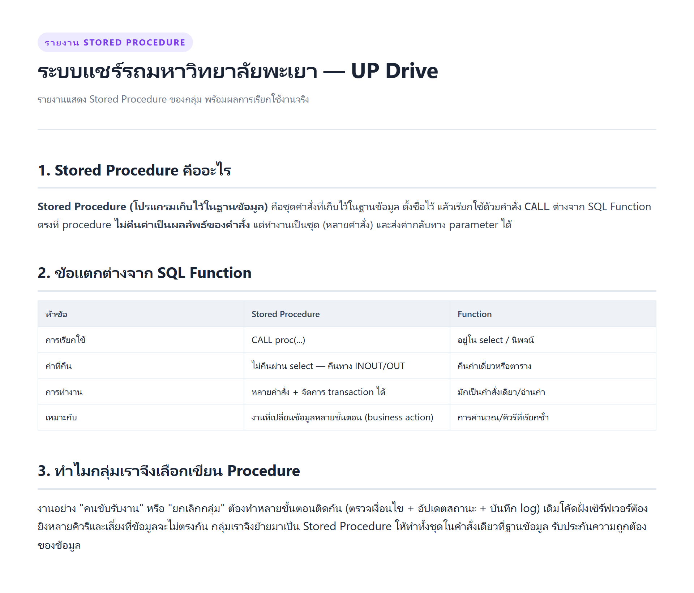
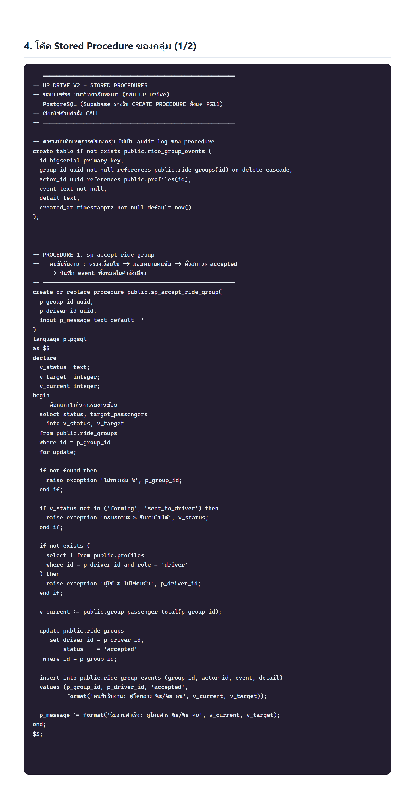
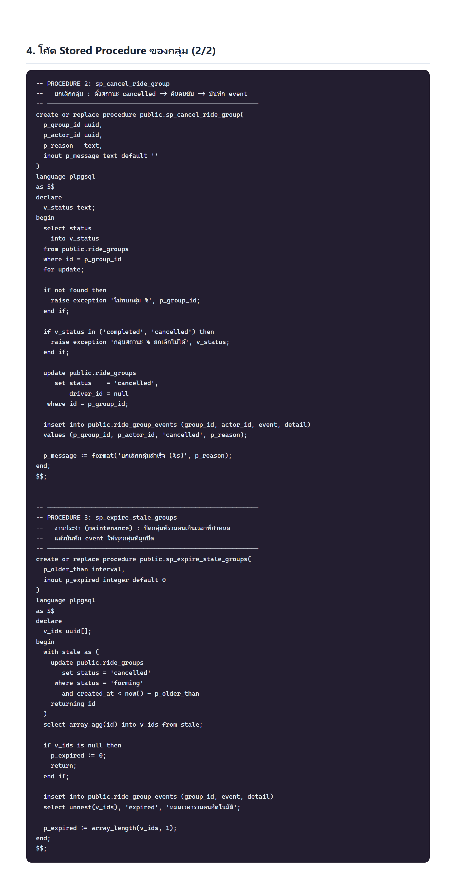
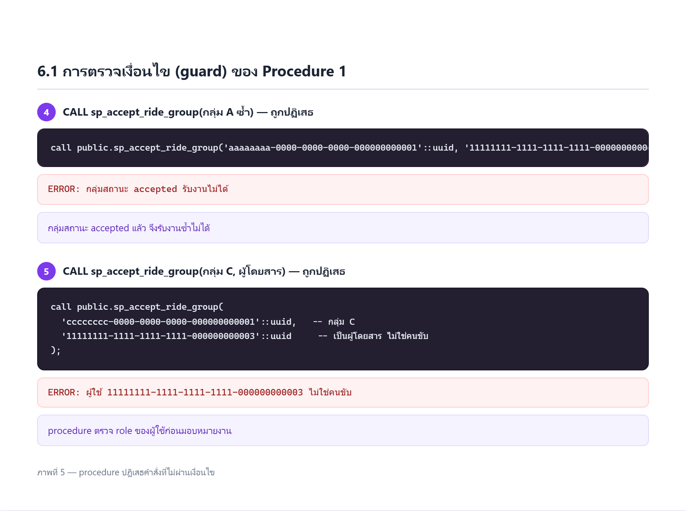
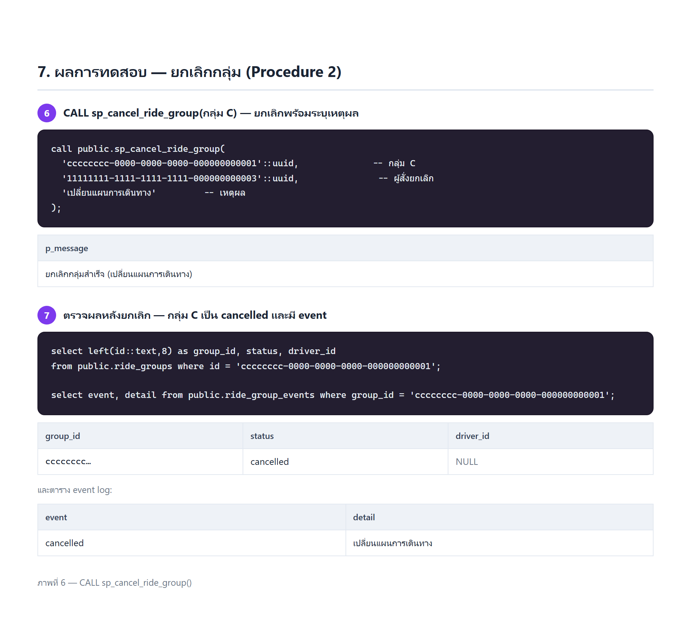
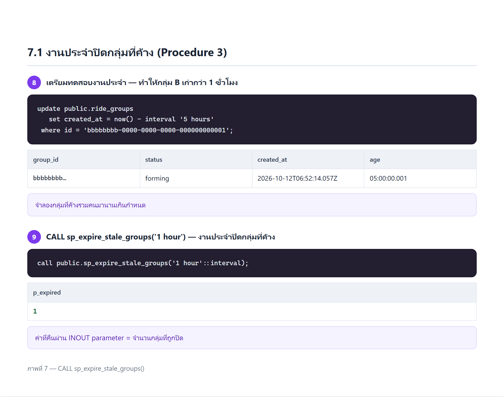
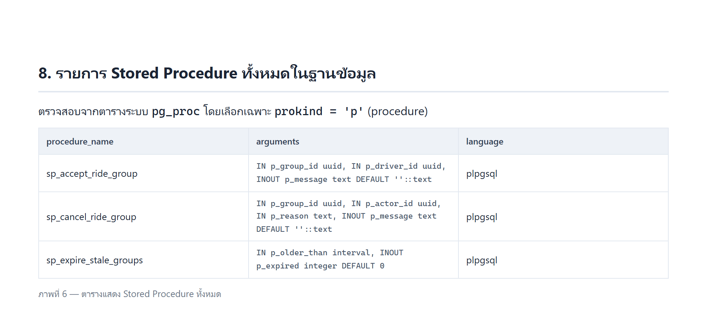

# รายงาน Stored Procedure — กลุ่ม UP Drive

**โครงงาน:** ระบบแชร์ค่ารถสำหรับนักศึกษา มหาวิทยาลัยพะเยา (UP Drive)
**ฐานข้อมูล:** PostgreSQL ผ่าน Supabase
**หัวข้อรายงาน:** Stored Procedure ของกลุ่ม
**สมาชิกในกลุ่ม:** _______________________

---



> รูปในรายงานนี้เป็น **ผลการ CALL procedure จริง** บน PostgreSQL 16
> (จำลองด้วย PGlite/WASM) ด้วย SQL ชุดเดียวกับที่ใช้บน Supabase
> ไฟล์ SQL ทั้งหมดอยู่ในโฟลเดอร์นี้ (`procedures.sql`, `test-procedure.sql`)

---

## 1. Stored Procedure คืออะไร

**Stored Procedure (โปรแกรมเก็บไว้ในฐานข้อมูล)** คือชุดคำสั่งที่เก็บไว้ในฐานข้อมูล ตั้งชื่อไว้
แล้วเรียกใช้ด้วยคำสั่ง `CALL` ต่างจาก SQL Function ตรงที่ procedure
**ไม่คืนค่าเป็นผลลัพธ์ของคำสั่ง** แต่ทำงานเป็นชุด (หลายคำสั่ง) และส่งค่ากลับทาง parameter ได้

## 2. ข้อแตกต่างจาก SQL Function

| หัวข้อ | Stored Procedure | Function |
| --- | --- | --- |
| การเรียกใช้ | `CALL proc(...)` | อยู่ใน `select` / นิพจน์ |
| ค่าที่คืน | ไม่คืนผ่าน select — คืนทาง `INOUT`/`OUT` | คืนค่าเดี่ยวหรือตาราง |
| การทำงาน | หลายคำสั่ง + จัดการ transaction ได้ | มักเป็นคำสั่งเดียว/อ่านค่า |
| เหมาะกับ | งานที่เปลี่ยนข้อมูลหลายขั้นตอน (business action) | การคำนวณ/คิวรีที่เรียกซ้ำ |

## 3. เหตุผลที่กลุ่มเลือกเขียน Procedure

งานอย่าง "คนขับรับงาน" หรือ "ยกเลิกกลุ่ม" ต้องทำหลายขั้นตอนติดกัน (ตรวจเงื่อนไข + อัปเดตสถานะ +
บันทึก log) เดิมโค้ดฝั่งเซิร์ฟเวอร์ต้องยิงหลายคิวรีและเสี่ยงที่ข้อมูลจะไม่ตรงกัน
กลุ่มเราจึงย้ายมาเป็น Stored Procedure ให้ทำทั้งชุดในคำสั่งเดียวที่ฐานข้อมูล

---

## 4. Stored Procedure ทั้ง 3 ตัวของกลุ่ม

| # | ชื่อ Procedure | หน้าที่ |
| --- | --- | --- |
| 1 | `sp_accept_ride_group(group_id, driver_id)` | คนขับรับงาน: ตรวจเงื่อนไข → มอบหมายคนขับ → ตั้งสถานะ accepted → บันทึก event |
| 2 | `sp_cancel_ride_group(group_id, actor_id, reason)` | ยกเลิกกลุ่ม: ตั้งสถานะ cancelled → คืนคนขับ → บันทึก event |
| 3 | `sp_expire_stale_groups(older_than)` | งานประจำ: ปิดกลุ่มที่รวมคนเกินเวลาที่กำหนด แล้วบันทึก event |





โค้ดเต็มอยู่ในไฟล์ [`procedures.sql`](procedures.sql) — สรุป PROCEDURE 1 (ตัวหลัก):

```sql
create or replace procedure public.sp_accept_ride_group(
  p_group_id uuid,
  p_driver_id uuid,
  inout p_message text default ''
)
language plpgsql
as $$
declare
  v_status text; v_target integer; v_current integer;
begin
  select status, target_passengers into v_status, v_target
  from public.ride_groups where id = p_group_id for update;

  if not found then raise exception 'ไม่พบกลุ่ม %', p_group_id; end if;
  if v_status not in ('forming','sent_to_driver') then
    raise exception 'กลุ่มสถานะ % รับงานไม่ได้', v_status;
  end if;
  if not exists (select 1 from public.profiles
                 where id = p_driver_id and role = 'driver') then
    raise exception 'ผู้ใช้ % ไม่ใช่คนขับ', p_driver_id;
  end if;

  v_current := public.group_passenger_total(p_group_id);

  update public.ride_groups
     set driver_id = p_driver_id, status = 'accepted'
   where id = p_group_id;

  insert into public.ride_group_events (group_id, actor_id, event, detail)
  values (p_group_id, p_driver_id, 'accepted',
          format('คนขับรับงาน: ผู้โดยสาร %s/%s คน', v_current, v_target));

  p_message := format('รับงานสำเร็จ: ผู้โดยสาร %s/%s คน', v_current, v_target);
end; $$;
```

**จุดออกแบบที่สำคัญ**

- ใช้ `for update` ล็อกแถวกันการรับงานซ้อน
- ตรวจเงื่อนไขด้วย `raise exception` จึงยกเลิกทั้งชุดคำสั่งถ้าข้อมูลไม่ถูกต้อง
- ส่งข้อความกลับผ่าน parameter แบบ `inout` (ไม่ใช่ค่าที่คืนจาก select)

---

## 5. ผลการทดสอบ — คนขับรับงาน (Procedure 1)


| ขั้น | การเรียก | ผลลัพธ์ |
| --- | --- | --- |
| 2 | `CALL sp_accept_ride_group(กลุ่ม A, คนขับ)` | `รับงานสำเร็จ: ผู้โดยสาร 3/4 คน` |
| 3 | ตรวจกลุ่ม A หลัง CALL | status = `accepted`, has_driver = `true`, มี event `accepted` |

### 5.1 การตรวจเงื่อนไข (guard)



| ขั้น | การเรียก | ผลลัพธ์ |
| --- | --- | --- |
| 4 | รับงานซ้ำ | `ERROR: กลุ่มสถานะ accepted รับงานไม่ได้` |
| 5 | ให้ผู้โดยสารรับงานแทนคนขับ | `ERROR: ผู้ใช้ ... ไม่ใช่คนขับ` |

---

## 6. ผลการทดสอบ — ยกเลิกกลุ่ม (Procedure 2)



| ขั้น | การเรียก | ผลลัพธ์ |
| --- | --- | --- |
| 6 | `CALL sp_cancel_ride_group(กลุ่ม C, ผู้โดยสาร, 'เปลี่ยนแผนการเดินทาง')` | `ยกเลิกกลุ่มสำเร็จ (เปลี่ยนแผนการเดินทาง)` |
| 7 | ตรวจกลุ่ม C | status = `cancelled`, driver_id = NULL, มี event `cancelled` |

### 6.1 งานประจำปิดกลุ่มที่ค้าง (Procedure 3)



- ขั้น 8: ทำให้กลุ่ม B มีอายุเกิน 1 ชั่วโมง
- ขั้น 9: `CALL sp_expire_stale_groups('1 hour')` → คืนค่าผ่าน INOUT = **1** (ปิด 1 กลุ่ม)

### 6.2 ตรวจสอบ event log


| event | detail | group |
| --- | --- | --- |
| accepted | คนขับรับงาน: ผู้โดยสาร 3/4 คน | aaaaaaaa |
| cancelled | เปลี่ยนแผนการเดินทาง | cccccccc |
| expired | หมดเวลารวมคนอัตโนมัติ | bbbbbbbb |

> ทุกการเปลี่ยนสถานะถูกบันทึกอัตโนมัติโดย procedure โดยไม่ต้องมีคำสั่ง insert แยกจากฝั่งแอป

---

## 7. รายการ Stored Procedure ทั้งหมดในฐานข้อมูล

ตรวจสอบจาก `pg_proc` โดยเลือกเฉพาะ `prokind = 'p'`



---

## 8. วิธีทดสอบซ้ำใน Supabase (ทำเองเพื่อเก็บภาพหน้าจอ)

1. เปิด **Supabase → SQL Editor** ของโปรเจกต์
2. เปิดไฟล์ [`test-procedure.sql`](test-procedure.sql) คัดลอกทั้งไฟล์วางแล้วกด **Run**
3. สคริปต์จะสร้าง procedure แล้วรันทดสอบทีละขั้น และสรุปผลลงตาราง `sp_demo_log`
4. **แคปหน้าจอ** ตาราง `sp_demo_log`, event log และรายการ procedure
5. ตอนจบให้รันคำสั่ง cleanup ในข้อ 6 เพื่อลบข้อมูลทดสอบ

เรียกจากแอปได้ด้วย `supabase.rpc('sp_accept_ride_group', { p_group_id, p_driver_id })`

---

## 9. สรุป

- กลุ่มเราเพิ่ม **Stored Procedure จำนวน 3 ตัว** เรียกใช้ด้วยคำสั่ง `CALL`
- ทดสอบแล้ว procedure ทำงานหลายขั้นตอนในคำสั่งเดียวได้จริง พร้อมบันทึก event log อัตโนมัติ
- การตรวจเงื่อนไขทำงานถูกต้อง: รับงานซ้ำถูกปฏิเสธ, ผู้โดยสารรับงานแทนคนขับถูกปฏิเสธ
- งานประจำ `sp_expire_stale_groups()` ปิดกลุ่มที่ค้างเกินเวลาได้ถูกต้อง และคืนจำนวนผ่าน INOUT

### ไฟล์ประกอบในโฟลเดอร์นี้

| ไฟล์ | รายละเอียด |
| --- | --- |
| `report.docx` | **ไฟล์ Word พร้อมรูป — อัปโหลดเข้า Google Drive แล้วเปิดเป็น Google Doc ได้เลย** |
| `report.md` | รายงานฉบับนี้ (Markdown) |
| `report.html` | รายงานฉบับเต็มสำหรับเปิดอ่าน/พิมพ์ |
| `procedures.sql` | โค้ด Stored Procedure ทั้ง 3 ตัว |
| `test-procedure.sql` | สคริปต์ทดสอบสำหรับรันใน Supabase SQL Editor |
| `screenshots/` | ภาพประกอบทั้ง 9 ภาพ |
| `fig*.html` | หน้าเว็บต้นทางของแต่ละภาพ |
| `demo/` | สคริปต์ที่ใช้รันทดสอบจริงและสร้างภาพ (PGlite) |
