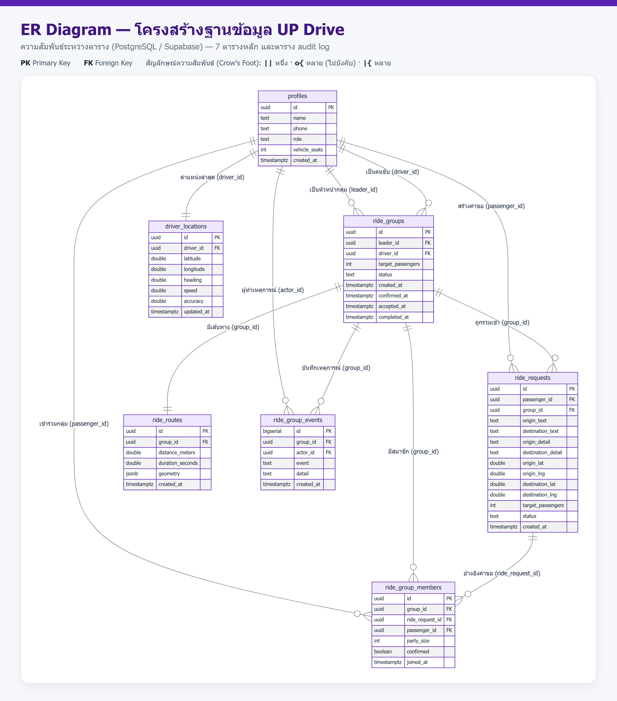

# เอกสารโครงสร้างฐานข้อมูล (Database Schema) — ระบบ UP Drive

ระบบแชร์ค่าเดินทางสำหรับนักศึกษา มหาวิทยาลัยพะเยา · ฐานข้อมูล: PostgreSQL (Supabase)
ไฟล์ Schema: `supabase.sql` · ไฟล์ทดสอบ: `supabase.test.sql`

---

## 1. ภาพรวมฐานข้อมูล

| หัวข้อ | รายละเอียด |
| --- | --- |
| ระบบจัดการฐานข้อมูล | PostgreSQL (โฮสต์บน Supabase) |
| จำนวนตาราง | 7 ตารางหลัก + 1 ตารางบันทึกเหตุการณ์ (`ride_group_events`) |
| จำนวนคอลัมน์รวม | 56 คอลัมน์ |
| Primary Key | ทุกตารางใช้คอลัมน์ `id` (uuid หรือ bigserial) |
| Foreign Key | 11 ความสัมพันธ์ |
| ดัชนี (Index) | 8 ดัชนี |
| ความปลอดภัย | เปิด Row Level Security (RLS) 6 ตารางหลัก + 6 policies |
| Database Trigger | 3 ตัว |
| SQL Function | 3 ตัว |
| Stored Procedure | 3 ตัว |

## 2. แผนภาพความสัมพันธ์ (ER Diagram)

## 3. ตารางสรุปโครงสร้าง (Schema Summary)

| ตาราง | หน้าที่ | คีย์หลัก | คีย์นอก (อ้างอิง) | คอลัมน์ |
| --- | --- | --- | --- | --- |
| `profiles` | ข้อมูลบัญชีผู้ใช้ (ผู้โดยสาร/คนขับ) | `id` | — (อ้าง `auth.users`) | 6 |
| `ride_groups` | กลุ่มเดินทาง | `id` | `leader_id`, `driver_id` → `profiles` | 9 |
| `ride_requests` | คำขอเดินทางของผู้โดยสาร | `id` | `passenger_id` → `profiles`, `group_id` → `ride_groups` | 14 |
| `ride_group_members` | สมาชิกในกลุ่ม | `id` | `group_id`, `ride_request_id`, `passenger_id` | 7 |
| `ride_routes` | เส้นทาง/ระยะทางของกลุ่ม | `id` | `group_id` → `ride_groups` (UNIQUE) | 6 |
| `driver_locations` | พิกัดล่าสุดของคนขับ (Realtime) | `id` | `driver_id` → `profiles` (UNIQUE) | 8 |
| `ride_group_events` | บันทึกเหตุการณ์ของกลุ่ม (audit log) | `id` | `group_id` → `ride_groups`, `actor_id` → `profiles` | 6 |

## 4. รายละเอียดคอลัมน์ (Data Dictionary)

> ดูตารางเต็มแยกตามตารางได้ในไฟล์ `report.docx`

## 5. ความสัมพันธ์ระหว่างตาราง (Foreign Keys)

| จาก (ตาราง.คอลัมน์) | ไปยัง | ความสัมพันธ์ | ON DELETE |
| --- | --- | --- | --- |
| `ride_groups.leader_id` | `profiles.id` | N : 1 | — |
| `ride_groups.driver_id` | `profiles.id` | N : 1 (NULL ได้) | — |
| `ride_requests.passenger_id` | `profiles.id` | N : 1 | — |
| `ride_requests.group_id` | `ride_groups.id` | N : 1 (NULL ได้) | SET NULL |
| `ride_group_members.group_id` | `ride_groups.id` | N : 1 | CASCADE |
| `ride_group_members.ride_request_id` | `ride_requests.id` | N : 1 | CASCADE |
| `ride_group_members.passenger_id` | `profiles.id` | N : 1 | CASCADE |
| `ride_routes.group_id` | `ride_groups.id` | 1 : 1 (UNIQUE) | CASCADE |
| `driver_locations.driver_id` | `profiles.id` | 1 : 1 (UNIQUE) | CASCADE |
| `ride_group_events.group_id` | `ride_groups.id` | N : 1 | CASCADE |
| `ride_group_events.actor_id` | `profiles.id` | N : 1 (NULL ได้) | — |

## 6. ดัชนี (Index)

| ชื่อ Index | ตาราง | คอลัมน์ |
| --- | --- | --- |
| `idx_ride_requests_passenger` | `ride_requests` | `passenger_id` |
| `idx_ride_requests_group` | `ride_requests` | `group_id` |
| `idx_ride_requests_status` | `ride_requests` | `status` |
| `idx_ride_groups_status` | `ride_groups` | `status` |
| `idx_ride_groups_driver` | `ride_groups` | `driver_id` |
| `idx_group_members_group` | `ride_group_members` | `group_id` |
| `idx_group_members_passenger` | `ride_group_members` | `passenger_id` |
| `idx_driver_locations_driver` | `driver_locations` | `driver_id` |

## 7. ความปลอดภัยระดับแถว (Row Level Security)

| ตาราง | Policy |
| --- | --- |
| `profiles` | `profiles_select_authenticated` |
| `ride_groups` | `groups_select_members_or_drivers` |
| `ride_requests` | `requests_select_owner_or_group_member` |
| `ride_group_members` | `members_select_group_users` |
| `ride_routes` | `routes_select_group_users` |
| `driver_locations` | `driver_locations_select_group_users` |

## 8. วัตถุฐานข้อมูลเชิงโปรแกรม

- **Trigger 3 ตัว:** `trg_ride_groups_status_timestamps`, `trg_ride_groups_driver_rules`, `trg_driver_locations_touch`
- **SQL Function 3 ตัว:** `haversine_km`, `group_passenger_total`, `find_candidate_groups`
- **Stored Procedure 3 ตัว:** `sp_accept_ride_group`, `sp_cancel_ride_group`, `sp_expire_stale_groups`

## 9. ภาคผนวก — โค้ด DDL (CREATE TABLE)

ดูโค้ดเต็มใน `report.docx` หรือไฟล์ `supabase.sql`

---

### ไฟล์ประกอบในโฟลเดอร์นี้

| ไฟล์ | รายละเอียด |
| --- | --- |
| `report.docx` | เอกสารโครงสร้างฐานข้อมูลฉบับสมบูรณ์ (พร้อม ER Diagram) |
| `report.md` | เอกสารฉบับนี้ (Markdown) |
| `screenshots/er-diagram.png` | ภาพ ER Diagram |
| `demo/build-schema-docx.mjs` | สคริปต์สร้างไฟล์ Word |
