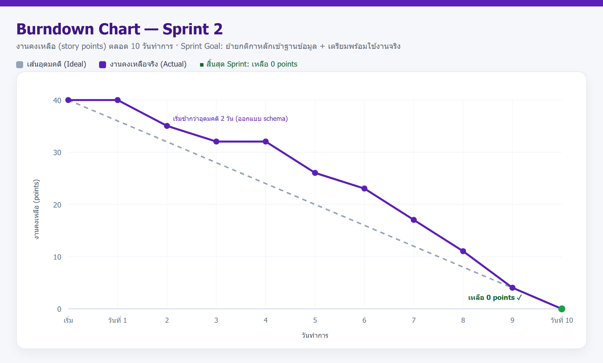
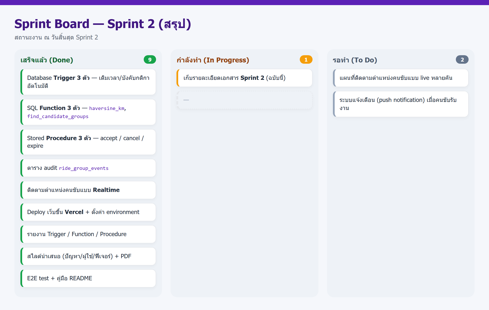
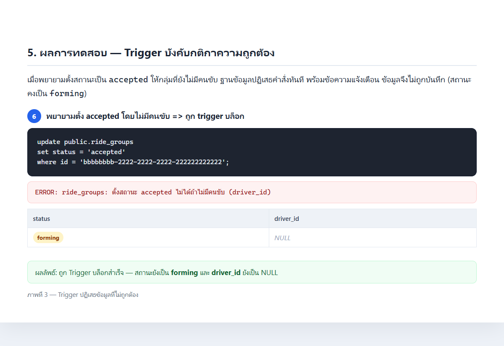
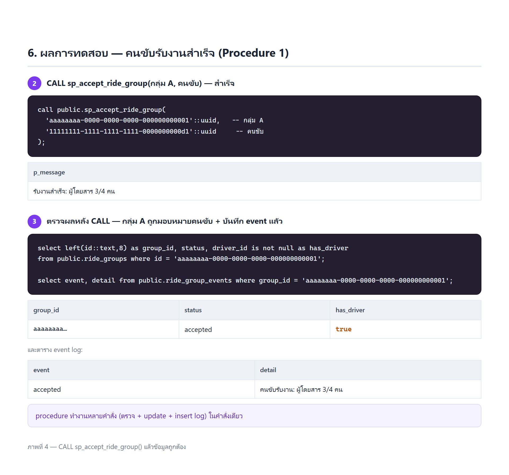
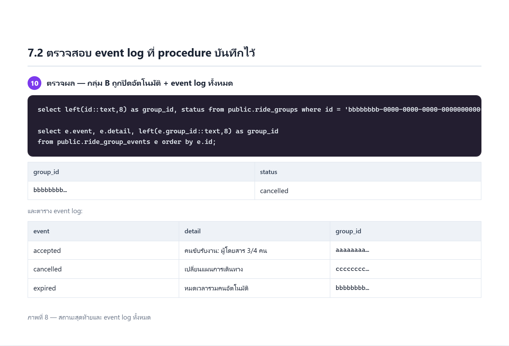
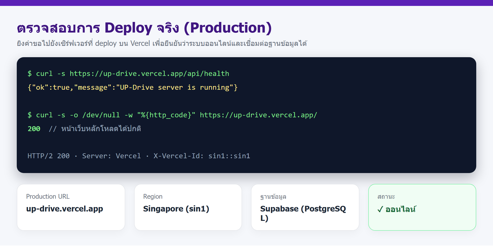

# รายงาน Sprint 2 — กลุ่ม UP Drive

**โครงงาน:** ระบบแชร์ค่าเดินทางสำหรับนักศึกษา มหาวิทยาลัยพะเยา (UP Drive)
**กระบวนการพัฒนา:** Agile / Scrum
**ระยะเวลา Sprint:** 10 วันทำการ (วันที่ ________ ถึง ________)
**สมาชิกในกลุ่ม:** _______________________________________

> เอกสารนี้สรุปงานที่กลุ่มทำจริงใน Sprint 2 — ย้ายกติกาสำคัญเข้าฐานข้อมูล เพิ่มการติดตามแบบ Realtime และ deploy เว็บขึ้นออนไลน์
> ตัวเลขคะแนน วันที่ และรายชื่อสมาชิก สามารถแก้ไขให้ตรงกับกลุ่มได้

---

## 1. ภาพรวม Sprint

| หัวข้อ | รายละเอียด |
| --- | --- |
| โครงงาน | UP Drive — ระบบแชร์ค่าเดินทางสำหรับนักศึกษา มหาวิทยาลัยพะเยา |
| Sprint | Sprint 2 |
| ระยะเวลา | 10 วันทำการ |
| **Sprint Goal** | ย้ายกติกาสำคัญของระบบเข้าสู่ฐานข้อมูล และเตรียมระบบให้พร้อมใช้งานจริงบนอินเทอร์เน็ต |
| ผลลัพธ์หลัก | Trigger 3 ตัว · SQL Function 3 ตัว · Stored Procedure 3 ตัว · ตาราง audit 1 ตาราง · Deploy บน Vercel · รายงาน 3 ฉบับ · สไลด์นำเสนอ 1 ชุด |
| สถานะ | ✅ แล้วเสร็จ (งานคงเหลือ 0 points) |

*ภาพที่ 1 — Burndown Chart ของ Sprint 2 (งานคงเหลือลดจาก 40 จุด เหลือ 0 เมื่อสิ้นสุด Sprint)*

*ภาพที่ 2 — Sprint Board สรุปสถานะงานเมื่อสิ้นสุด Sprint 2*

---

## 2. บทนำ: จาก Sprint 1 สู่ Sprint 2

ใน Sprint 1 กลุ่มเราสร้างส่วนหลักของแอปพลิเคชันให้ใช้งานได้ครบวงจร ได้แก่ การสมัคร/เข้าสู่ระบบ การประกาศเส้นทางความต้องการเดินทางพร้อมปักหมุดจุดรับ–ส่งบนแผนที่ (GPS) การจับคู่ผู้โดยสารที่ไปทางเดียวกันเป็นกลุ่ม และหน้า Dashboard สำหรับคนขับ พร้อมแผนที่และประวัติการเดินทาง

อย่างไรก็ตาม ใน Sprint 1 ตรรกะสำคัญหลายอย่างยังอยู่ที่โค้ดฝั่งเซิร์ฟเวอร์ (Node.js) เช่น การตั้งเวลา `confirmed_at` / `accepted_at` / `completed_at` และการตรวจว่ากลุ่มมีคนขับหรือยัง ทำให้ถ้ามีการแก้ข้อมูลผ่านช่องทางอื่น (เช่น Supabase SQL Editor) กติกาเหล่านั้นจะถูกข้ามได้

**Sprint 2 จึงโฟกัส 2 เรื่องหลัก**

- **ความถูกต้องของข้อมูล** — ย้ายกติกาสำคัญเข้าฐานข้อมูลด้วย Database Trigger, SQL Function และ Stored Procedure พร้อมเพิ่มตารางบันทึกเหตุการณ์ (audit log)
- **ความพร้อมใช้งานจริง** — เพิ่มการติดตามตำแหน่งคนขับแบบ Realtime และ deploy เว็บขึ้นออนไลน์ พร้อมชุดทดสอบและเอกสารประกอบ

---

## 3. Sprint Goal และขอบเขตงาน

> **Sprint Goal:** ทำให้ข้อมูลของระบบถูกต้องเสมอไม่ว่าจะแก้จากช่องทางใด โดยย้ายกติกาสำคัญเข้าฐานข้อมูล และนำระบบขึ้นออนไลน์ให้ใช้งานได้จริง

**อยู่ในขอบเขต (In scope)**

- Database Trigger 3 ตัว — เติมเวลาและบังคับกติกาความถูกต้องอัตโนมัติ
- SQL Function 3 ตัว — คำนวณระยะทาง (Haversine), นับผู้โดยสารรวม, หากลุ่มที่ใกล้ที่สุด
- Stored Procedure 3 ตัว — รับงาน / ยกเลิกกลุ่ม / ปิดกลุ่มที่ค้าง พร้อมบันทึก event log
- การติดตามตำแหน่งคนขับแบบ Realtime
- Deploy เว็บขึ้นออนไลน์ (Vercel) และชุดทดสอบ + เอกสาร

**นอกขอบเขต (Out of scope)**

- ระบบชำระเงิน/กระเป๋าเงิน
- ระบบแจ้งเตือนแบบ push notification (เลื่อนไป Sprint ถัดไป)

---

## 4. Sprint Backlog

| รหัส | งาน | รายละเอียด | คะแนน | สถานะ |
| --- | --- | --- | :---: | :---: |
| S2-01 | ออกแบบ schema / วิเคราะห์กติกา | วิเคราะห์กติกาที่ควรย้ายเข้าฐานข้อมูล และออกแบบตาราง event log | 5 | เสร็จ |
| S2-02 | Database Trigger 3 ตัว | เติมเวลา / บังคับกติกา / อัปเดตพิกัดคนขับ | 5 | เสร็จ |
| S2-03 | SQL Function 3 ตัว | `haversine_km`, `group_passenger_total`, `find_candidate_groups` | 5 | เสร็จ |
| S2-04 | Stored Procedure 3 ตัว | `sp_accept` / `sp_cancel` / `sp_expire` | 5 | เสร็จ |
| S2-05 | ตาราง audit `ride_group_events` | บันทึกเหตุการณ์สำคัญของกลุ่มเดินทาง | 2 | เสร็จ |
| S2-06 | ติดตามตำแหน่ง Realtime | แสดง/รับตำแหน่งคนขับแบบเรียลไทม์ด้วย Supabase Realtime | 4 | เสร็จ |
| S2-07 | Deploy ขึ้น Vercel | ตั้งค่า environment, region sin1 (Singapore) | 4 | เสร็จ |
| S2-08 | รายงาน 3 ฉบับ | Trigger / Function / Procedure พร้อมภาพผลทดสอบจริง | 3 | เสร็จ |
| S2-09 | สไลด์นำเสนอ | ปัญหา / ผู้ใช้ / ฟีเจอร์ (pptx + PDF) | 2 | เสร็จ |
| S2-10 | E2E test + คู่มือ | แผนทดสอบกรณีของ ride request และ README | 3 | เสร็จ |
| S2-11 | เอกสาร Sprint 2 | เอกสารฉบับนี้ | 2 | เสร็จ |
| | | **รวม** | **40** | |

---

## 5. งานที่ส่งมอบ (Increment)

### 5.1 โครงสร้างฐานข้อมูล (ER Diagram)

แผนภาพความสัมพันธ์ระหว่างตาราง (Entity–Relationship Diagram) ของฐานข้อมูล 7 ตารางหลัก ได้แก่ `profiles`, `ride_groups`, `ride_requests`, `ride_group_members`, `ride_routes`, `driver_locations` และตารางบันทึกเหตุการณ์ `ride_group_events` โดยใช้สัญลักษณ์ Crow's Foot แสดงความสัมพันธ์แบบหนึ่ง-ต่อ-หลาย (1:N) และหนึ่ง-ต่อ-หนึ่ง (1:1)

**ตารางสรุปโครงสร้างฐานข้อมูล (Schema Summary)**

| ตาราง | หน้าที่ | คีย์หลัก | คีย์นอก (อ้างอิง) | คอลัมน์ |
| --- | --- | --- | --- | --- |
| `profiles` | ข้อมูลบัญชีผู้ใช้ (ผู้โดยสาร/คนขับ) ผูกกับระบบล็อกอิน | `id` | — (อ้าง `auth.users`) | 6 |
| `ride_groups` | กลุ่มเดินทาง ตั้งแต่เริ่มรวมคนจนจบงาน | `id` | `leader_id`, `driver_id` → `profiles` | 9 |
| `ride_requests` | คำขอเดินทางของผู้โดยสารหนึ่งคน พร้อมพิกัดต้นทาง–ปลายทาง | `id` | `passenger_id` → `profiles`, `group_id` → `ride_groups` | 14 |
| `ride_group_members` | สมาชิกในกลุ่ม (เชื่อม กลุ่ม ↔ คำขอ ↔ ผู้โดยสาร) | `id` | `group_id` → `ride_groups`, `ride_request_id` → `ride_requests`, `passenger_id` → `profiles` | 7 |
| `ride_routes` | เส้นทาง/ระยะทางของกลุ่ม (1 กลุ่ม : 1 เส้นทาง) | `id` | `group_id` → `ride_groups` (UNIQUE) | 6 |
| `driver_locations` | พิกัดล่าสุดของคนขับ สำหรับติดตามแบบ Realtime | `id` | `driver_id` → `profiles` (UNIQUE) | 8 |
| `ride_group_events` | บันทึกเหตุการณ์ของกลุ่ม (audit log) | `id` | `group_id` → `ride_groups`, `actor_id` → `profiles` | 6 |

**รายละเอียดคอลัมน์ทั้งหมด (Data Dictionary)**

| ตาราง | คอลัมน์ | ชนิดข้อมูล | คีย์ / ข้อกำหนด |
| --- | --- | --- | --- |
| `profiles` | `id` | uuid | PK · อ้าง `auth.users(id)` |
| | `name` | text | NOT NULL |
| | `phone` | text | — |
| | `role` | text | NOT NULL · CHECK (passenger, driver) |
| | `vehicle_seats` | integer | NOT NULL · DEFAULT 4 · CHECK 1–10 |
| | `created_at` | timestamptz | NOT NULL · DEFAULT now() |
| `ride_groups` | `id` | uuid | PK · DEFAULT gen_random_uuid() |
| | `leader_id` | uuid | FK → `profiles(id)` · NOT NULL |
| | `target_passengers` | integer | NOT NULL · CHECK 1–10 |
| | `status` | text | NOT NULL · DEFAULT 'forming' · CHECK (forming, sent_to_driver, accepted, completed, cancelled) |
| | `driver_id` | uuid | FK → `profiles(id)` · เป็น NULL ได้ |
| | `created_at` | timestamptz | NOT NULL · DEFAULT now() |
| | `confirmed_at` | timestamptz | เติมอัตโนมัติโดย Trigger |
| | `accepted_at` | timestamptz | เติมอัตโนมัติโดย Trigger |
| | `completed_at` | timestamptz | เติมอัตโนมัติโดย Trigger |
| `ride_requests` | `id` | uuid | PK · DEFAULT gen_random_uuid() |
| | `passenger_id` | uuid | FK → `profiles(id)` · NOT NULL |
| | `group_id` | uuid | FK → `ride_groups(id)` · ON DELETE SET NULL |
| | `origin_text` | text | NOT NULL |
| | `destination_text` | text | NOT NULL |
| | `origin_detail` | text | — |
| | `destination_detail` | text | — |
| | `origin_lat` | double precision | NOT NULL |
| | `origin_lng` | double precision | NOT NULL |
| | `destination_lat` | double precision | NOT NULL |
| | `destination_lng` | double precision | NOT NULL |
| | `target_passengers` | integer | NOT NULL · CHECK 1–10 |
| | `status` | text | NOT NULL · DEFAULT 'searching' · CHECK (searching, matched, sent_to_driver, accepted, completed, cancelled) |
| | `created_at` | timestamptz | NOT NULL · DEFAULT now() |
| `ride_group_members` | `id` | uuid | PK · DEFAULT gen_random_uuid() |
| | `group_id` | uuid | FK → `ride_groups(id)` · NOT NULL · ON DELETE CASCADE · UNIQUE(group_id, passenger_id), UNIQUE(group_id, ride_request_id) |
| | `ride_request_id` | uuid | FK → `ride_requests(id)` · NOT NULL · ON DELETE CASCADE |
| | `passenger_id` | uuid | FK → `profiles(id)` · NOT NULL · ON DELETE CASCADE |
| | `party_size` | integer | NOT NULL · DEFAULT 1 · CHECK 1–10 |
| | `confirmed` | boolean | NOT NULL · DEFAULT false |
| | `joined_at` | timestamptz | NOT NULL · DEFAULT now() |
| `ride_routes` | `id` | uuid | PK · DEFAULT gen_random_uuid() |
| | `group_id` | uuid | FK → `ride_groups(id)` · NOT NULL · UNIQUE · ON DELETE CASCADE |
| | `distance_meters` | double precision | — |
| | `duration_seconds` | double precision | — |
| | `geometry` | jsonb | — |
| | `created_at` | timestamptz | NOT NULL · DEFAULT now() |
| `driver_locations` | `id` | uuid | PK · DEFAULT gen_random_uuid() |
| | `driver_id` | uuid | FK → `profiles(id)` · NOT NULL · UNIQUE · ON DELETE CASCADE |
| | `latitude` | double precision | NOT NULL |
| | `longitude` | double precision | NOT NULL |
| | `heading` | double precision | — |
| | `speed` | double precision | — |
| | `accuracy` | double precision | — |
| | `updated_at` | timestamptz | NOT NULL · DEFAULT now() · อัปเดตโดย Trigger |
| `ride_group_events` | `id` | bigserial | PK (running number) |
| | `group_id` | uuid | FK → `ride_groups(id)` · NOT NULL · ON DELETE CASCADE |
| | `actor_id` | uuid | FK → `profiles(id)` · เป็น NULL ได้ |
| | `event` | text | NOT NULL |
| | `detail` | text | — |
| | `created_at` | timestamptz | NOT NULL · DEFAULT now() |

### 5.2 Database Trigger (3 ตัว)

| # | ชื่อ Trigger | ตาราง | Event / Timing | หน้าที่ |
| --- | --- | --- | --- | --- |
| 1 | `trg_ride_groups_status_timestamps` | `ride_groups` | BEFORE UPDATE | เติม `confirmed_at` / `accepted_at` / `completed_at` อัตโนมัติเมื่อสถานะเปลี่ยน |
| 2 | `trg_ride_groups_driver_rules` | `ride_groups` | BEFORE UPDATE | บล็อก (RAISE EXCEPTION) ถ้าตั้งสถานะ `accepted` แต่ยังไม่มีคนขับ |
| 3 | `trg_driver_locations_touch` | `driver_locations` | BEFORE UPDATE | อัปเดต `updated_at` ทุกครั้งที่พิกัดคนขับเปลี่ยน |

### 5.3 SQL Function (3 ตัว)

| # | ชื่อฟังก์ชัน | ประเภท | หน้าที่ |
| --- | --- | --- | --- |
| 1 | `haversine_km(lat1,lng1,lat2,lng2)` | Scalar | คำนวณระยะทางระหว่างพิกัด 2 จุด (km) ด้วยสูตร Haversine |
| 2 | `group_passenger_total(group_id)` | Scalar | นับจำนวนผู้โดยสารรวมของกลุ่ม (ผลรวม `party_size`) |
| 3 | `find_candidate_groups(...)` | Table | หากลุ่มที่กำลังรวมคนซึ่งใกล้คำขอใหม่ คืนเป็นตารางพร้อมคะแนน (`score`) |

### 5.4 Stored Procedure (3 ตัว)

| # | ชื่อ Procedure | หน้าที่ |
| --- | --- | --- |
| 1 | `sp_accept_ride_group(group_id, driver_id)` | คนขับรับงาน: ตรวจเงื่อนไข → มอบหมายคนขับ → ตั้งสถานะ accepted → บันทึก event |
| 2 | `sp_cancel_ride_group(group_id, actor_id, reason)` | ยกเลิกกลุ่ม: ตั้งสถานะ cancelled → คืนคนขับ → บันทึก event |
| 3 | `sp_expire_stale_groups(older_than)` | งานประจำ: ปิดกลุ่มที่รวมคนเกินเวลาที่กำหนด แล้วบันทึก event (คืนจำนวนทาง INOUT) |

### 5.5 ตารางบันทึกเหตุการณ์ (`ride_group_events`)

ตารางใหม่ที่ใช้เก็บเหตุการณ์สำคัญของกลุ่มเดินทาง (accepted / cancelled / expired) โดยถูกเขียนอัตโนมัติจาก Stored Procedure ทำให้ตรวจสอบย้อนหลังได้ว่ากลุ่มหนึ่ง ๆ เกิดอะไรขึ้นเมื่อไร และใครเป็นผู้ทำ

### 5.6 การติดตามตำแหน่งแบบ Realtime

คนขับส่งพิกัดปัจจุบันเข้าตาราง `driver_locations` และ Trigger จะอัปเดต `updated_at` ให้เอง ฝั่งผู้โดยสารติดตามการเปลี่ยนแปลงแบบ Realtime ผ่าน Supabase Realtime จึงเห็นตำแหน่งคนขับที่อัปเดตโดยไม่ต้องรีเฟรชหน้า

### 5.7 Deploy ขึ้นออนไลน์ (Vercel)

นำเว็บแอป (Node.js + Express) ขึ้นโฮสต์บน Vercel โดยตั้งค่า environment variables (`SUPABASE_URL`, `SUPABASE_SECRET_KEY`) และกำหนด region เป็น Singapore (sin1) เพื่อให้ตอบสนองเร็วในไทย ผลลัพธ์คือระบบออนไลน์จริงที่เข้าถึงได้จากทุกที่

### 5.8 เอกสารและสื่อนำเสนอ

- รายงาน 3 ฉบับ: Database Trigger / SQL Function / Stored Procedure
- สไลด์นำเสนอโครงงาน (ปัญหา / ผู้ใช้ / ฟีเจอร์) ทั้งไฟล์ PowerPoint และ PDF
- คู่มือ README และไฟล์ SQL สำหรับสร้างฐานข้อมูล (`supabase.sql`, `supabase.test.sql`)

---

## 6. ผลการทดสอบ (หลักฐาน)

> ทดสอบด้วย SQL ชุดเดียวกับที่ใช้บน Supabase บน PostgreSQL 16 (จำลองด้วย PGlite/WASM) และทดสอบระบบที่ deploy จริงบน Vercel

### 6.1 Database Trigger

*ภาพที่ 3 — Trigger เติมเวลา confirmed_at / accepted_at / completed_at อัตโนมัติตามสถานะ*

*ภาพที่ 4 — ฐานข้อมูลปฏิเสธ (ERROR) เมื่อตั้งสถานะ accepted โดยไม่มีคนขับ*

| กรณีทดสอบ | ผลลัพธ์ที่ได้ | ผล |
| --- | --- | :---: |
| เปลี่ยนสถานะ forming → sent_to_driver | `confirmed_at` ถูกเติมอัตโนมัติ | ผ่าน |
| เปลี่ยนสถานะ → accepted / completed | `accepted_at` / `completed_at` ถูกเติมอัตโนมัติ | ผ่าน |
| แก้ฟิลด์อื่น (`target_passengers`) | ค่าเวลาเดิมไม่ถูกเขียนทับ | ผ่าน |
| ตั้ง accepted โดยไม่มีคนขับ | ถูกบล็อกด้วย ERROR | ผ่าน |
| แก้พิกัดคนขับ | `updated_at` อัปเดตเอง | ผ่าน |

### 6.2 SQL Function

*ภาพที่ 5 — ผลของ haversine_km() และ group_passenger_total()*

*ภาพที่ 6 — ผลของ find_candidate_groups() เรียงตามคะแนน และกรองกลุ่มที่ไกลเกินระยะ*

| กรณีทดสอบ | ผลลัพธ์ที่ได้ | ผล |
| --- | --- | :---: |
| `haversine_km()` กับพิกัดที่ทราบค่า | ได้ 0.107 / 0.383 / 4.965 km ตรงตามพิกัด | ผ่าน |
| `group_passenger_total()` | กลุ่ม A = 3 (party_size), กลุ่มว่าง = 0 | ผ่าน |
| `find_candidate_groups()` ระยะ 4 km | คืนเฉพาะกลุ่มที่ใกล้ พร้อมคะแนน เรียงถูกต้อง | ผ่าน |
| ปรับรัศมีเป็น 0.3 km | เหลือเฉพาะกลุ่มที่ใกล้ที่สุด (รับ parameter ได้จริง) | ผ่าน |

### 6.3 Stored Procedure

*ภาพที่ 7 — CALL sp_accept_ride_group() แล้วข้อมูลถูกต้อง*

*ภาพที่ 8 — event log บันทึกเหตุการณ์อัตโนมัติครบถ้วน*

| กรณีทดสอบ | ผลลัพธ์ที่ได้ | ผล |
| --- | --- | :---: |
| คนขับรับงาน (ปกติ) | สถานะ = accepted, มีคนขับ, มี event accepted | ผ่าน |
| รับงานซ้ำ | ถูกปฏิเสธ: กลุ่มสถานะ accepted รับงานไม่ได้ | ผ่าน |
| ให้ผู้โดยสารรับงานแทนคนขับ | ถูกปฏิเสธ: ผู้ใช้ไม่ใช่คนขับ | ผ่าน |
| ยกเลิกกลุ่ม | สถานะ = cancelled, คืนคนขับ, มี event cancelled | ผ่าน |
| ปิดกลุ่มที่ค้าง (expire) | คืนค่า 1 ทาง INOUT, มี event expired | ผ่าน |

### 6.4 การ Deploy จริง (Production)

*ภาพที่ 9 — ตรวจสอบเซิร์ฟเวอร์ที่ deploy จริง: /api/health ตอบ ok และหน้าเว็บหลักโหลดได้ (HTTP 200)*

| รายการตรวจสอบ | ผลลัพธ์ | ผล |
| --- | --- | :---: |
| `GET /api/health` | `{"ok":true,"message":"UP-Drive server is running"}` | ผ่าน |
| `GET /` (หน้าเว็บหลัก) | HTTP 200 | ผ่าน |
| เชื่อมต่อฐานข้อมูล Supabase | เรียก `POST /api/auth/login` ได้ (ฐานข้อมูลตอบสนอง) | ผ่าน |
| Region | Singapore (sin1) | ผ่าน |

### 6.5 ชุดทดสอบอัตโนมัติ (E2E)

| รหัส | การทดสอบ | ผลที่คาดหวัง |
| --- | --- | --- |
| TC-01 | สร้างคำขอเดินทางด้วยข้อมูลถูกต้อง | HTTP 201, ได้ ride id และ passenger id |
| TC-02 | อ่านคำขอที่สร้างใน TC-01 | HTTP 200, ค่าตรงกับที่สร้าง |
| TC-03 | ยกเลิกคำขอนั้น | HTTP 200, สถานะกลายเป็น cancelled |
| TC-04 | สร้างคำขอโดยไม่มีต้นทาง | HTTP 400, ไม่มีข้อมูลถูกสร้าง |

---

## 7. Definition of Done

- โค้ด SQL รันผ่านจริงบน PostgreSQL ไม่มี error
- มีกรณีทดสอบที่ยืนยันทั้งเส้นทางที่ถูกต้องและเส้นทางที่ผิด (guard / validation)
- มีภาพผลการรันจริงประกอบในเอกสาร
- โค้ดถูกใส่ในไฟล์ schema จริงของโปรเจกต์ (`supabase.sql`) พร้อมใช้งานเมื่อสร้างฐานข้อมูลใหม่
- ฟีเจอร์ที่เกี่ยวกับผู้ใช้ถูกทดสอบบนเว็บที่ deploy จริงแล้ว
- เพื่อนร่วมกลุ่มทบทวน (review) และ merge เข้า branch `main` แล้ว

---

## 8. Sprint Review (ผลการนำเสนอ)

- สาธิตการ deploy จริง: เปิดเว็บ https://up-drive.vercel.app และทดสอบการเข้าสู่ระบบ
- สาธิต Trigger: เปลี่ยนสถานะกลุ่มแล้วเห็นเวลาถูกเติมเอง และการถูกบล็อกเมื่อตั้ง accepted โดยไม่มีคนขับ
- สาธิต Function: เรียก `find_candidate_groups()` แล้วเห็นผลการจับคู่พร้อมคะแนน
- สาธิต Procedure: เรียก `sp_accept_ride_group()` แล้วเห็นสถานะเปลี่ยนพร้อม event log
- นำเสนอสไลด์สรุป ปัญหา / ผู้ใช้ / ฟีเจอร์ ของโครงงาน

---

## 9. Sprint Retrospective

| สิ่งที่ทำได้ดี | สิ่งที่ควรปรับปรุง | จะทำใน Sprint ถัดไป |
| --- | --- | --- |
| ย้ายกติกาสำคัญเข้าฐานข้อมูลสำเร็จ ทำให้ข้อมูลถูกต้องไม่ว่าแก้จากทางไหน | ช่วงแรกใช้เวลาออกแบบ schema นาน งานจึงเริ่มช้ากว่าอุดมคติ 2 วัน | แบ่งงานออกแบบให้เล็กลงและประเมินเวลาเผื่อมากขึ้น |
| มีการทดสอบจริงพร้อมภาพหลักฐานทุกหัวข้อ | เอกสารและภาพประกอบใช้เวลามาก ควรทำไปพร้อมกับงาน | เขียนเอกสารประกอบทันทีหลังปิดงานแต่ละชิ้น |
| Deploy จริงและทดสอบบน production ได้ | ควรมีระบบแจ้งเตือนเมื่อ deploy ล้มเหลว | ตั้งค่า monitoring/แจ้งเตือนการ deploy |

---

## 10. ปัญหาและอุปสรรค

| ปัญหา | วิธีแก้ไข |
| --- | --- |
| ตรรกะสำคัญอยู่ที่โค้ดฝั่งแอป ทำให้กติกาถูกข้ามได้เมื่อแก้ข้อมูลตรง | ย้ายกติกาเข้าฐานข้อมูลด้วย Trigger และ Procedure |
| การรับงาน/ยกเลิกกลุ่มเดิมยิงหลายคำสั่ง เสี่ยงข้อมูลไม่ตรงกัน | รวมเป็น Stored Procedure เดียว จัดการใน transaction และใช้ `FOR UPDATE` ล็อกแถว |
| หน้าจอผู้ใช้อัปเดตช้ากว่าข้อมูลจริง | ใช้ Supabase Realtime ติดตามการเปลี่ยนแปลงของตำแหน่งคนขับ |
| ไม่เคยมีประสบการณ์ deploy ขึ้นโฮสต์จริง | ศึกษาการ deploy แบบ zero-config ของ Vercel และทดสอบ `/api/health` หลัง deploy |

---

## 11. แผน Sprint ถัดไป (Sprint 3)

- แผนที่ติดตามตำแหน่งคนขับแบบ live หลายคันพร้อมกัน
- ระบบแจ้งเตือน (push notification) เมื่อคนขับรับงานหรือใกล้ถึงจุดรับ
- ปรับปรุง UI/UX ให้ใช้งานบนมือถือสะดวกขึ้น และเพิ่มการประเมินคนขับ
- เพิ่ม test coverage และระบบ monitoring ของการ deploy

---

## 12. สรุป

- Sprint 2 ทำสำเร็จตาม Sprint Goal: ย้ายกติกาสำคัญเข้าฐานข้อมูลและนำระบบขึ้นออนไลน์จริง
- ส่งมอบงานฐานข้อมูล 9 วัตถุ (Trigger 3 · Function 3 · Procedure 3) พร้อมตาราง audit
- ทดสอบครบทั้งเส้นทางถูกต้องและเส้นทางผิด ได้ผลผ่านทุกกรณี พร้อมภาพหลักฐาน
- ระบบพร้อมใช้งานจริงที่ https://up-drive.vercel.app และมีชุดทดสอบ + เอกสารประกอบครบ

---

## 13. ภาคผนวก — ลิงก์และไฟล์ที่เกี่ยวข้อง

| รายการ | ที่อยู่ / ไฟล์ |
| --- | --- |
| เว็บไซต์ที่ deploy จริง | https://up-drive.vercel.app |
| ซอร์สโค้ด (GitHub) | github.com/phathon2006/-UP-drive |
| Schema ฐานข้อมูล | `supabase.sql` / `supabase.test.sql` |
| รายงาน Trigger | `docs/trigger-report/report.docx` |
| รายงาน Function | `docs/function-report/report.docx` |
| รายงาน Procedure | `docs/procedure-report/report.docx` |
| สไลด์นำเสนอ | `docs/slides/UP-Drive-Slides.pptx` (`.pdf`) |
| แผนทดสอบ | `TEST-PLAN.md` |

### ไฟล์ประกอบในโฟลเดอร์นี้

| ไฟล์ | รายละเอียด |
| --- | --- |
| `report.docx` | **ไฟล์ Word พร้อมรูป — อัปโหลดเข้า Google Drive แล้วเปิดเป็น Google Doc ได้เลย** |
| `report.md` | รายงานฉบับนี้ (Markdown) |
| `screenshots/` | ภาพประกอบทั้ง 10 ภาพ |
| `fig*.html` | หน้าเว็บต้นทางของภาพ burndown / board / deploy / ER Diagram |
| `demo/` | สคริปต์ที่ใช้สร้างไฟล์ Word |
