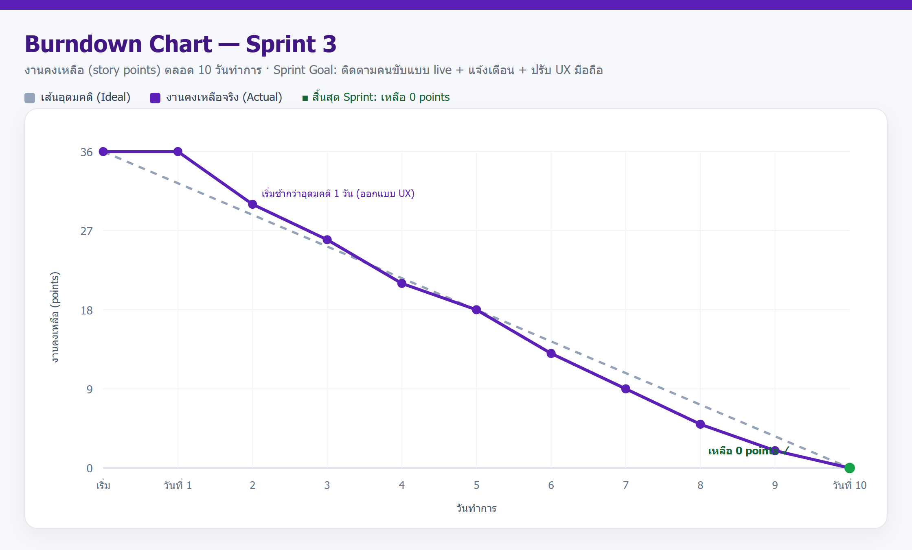
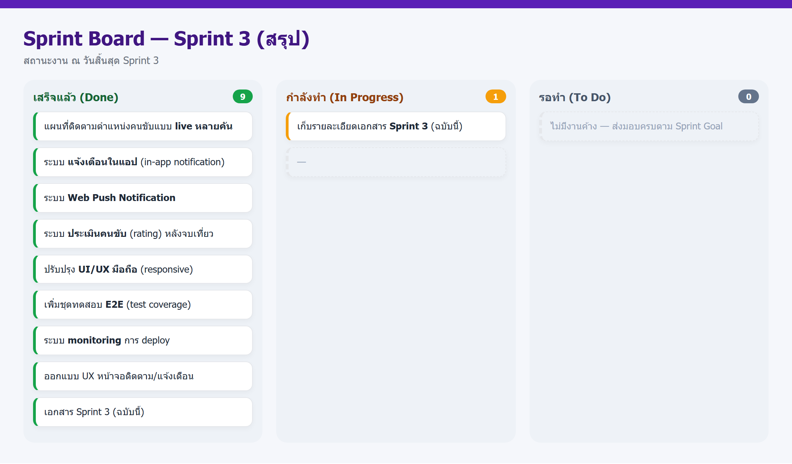
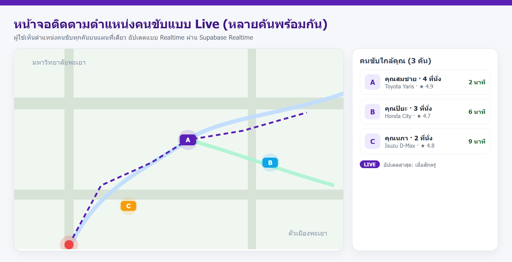
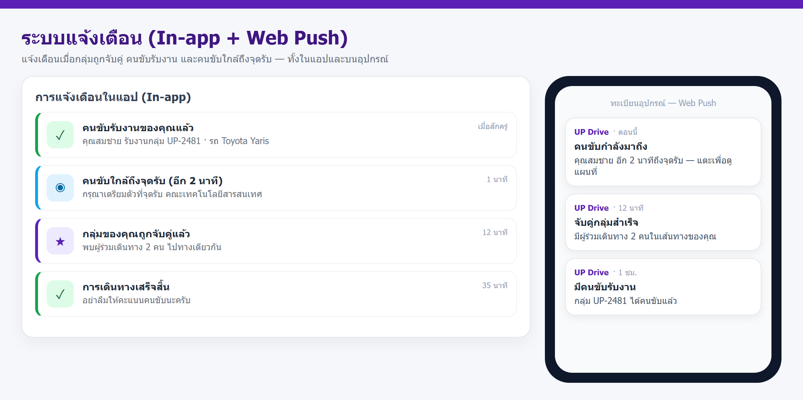
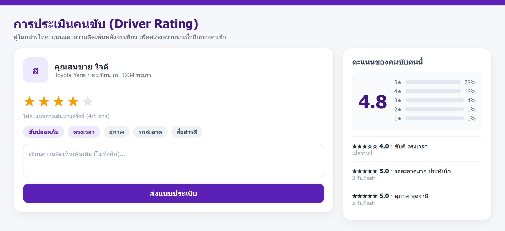
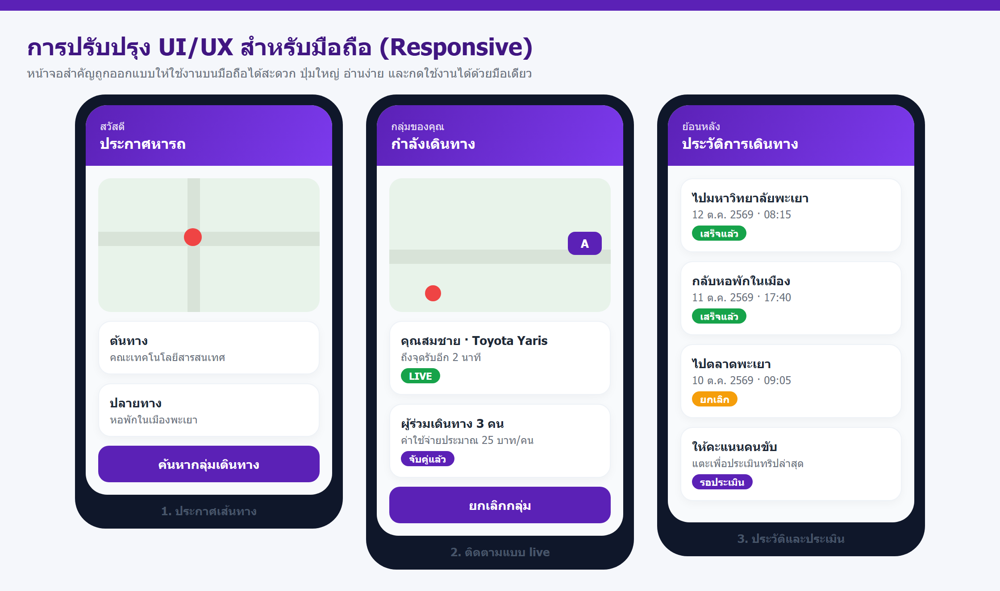

# รายงาน Sprint 3 — กลุ่ม UP Drive

**โครงงาน:** ระบบแชร์ค่าเดินทางสำหรับนักศึกษา มหาวิทยาลัยพะเยา (UP Drive)
**กระบวนการพัฒนา:** Agile / Scrum
**ระยะเวลา Sprint:** 10 วันทำการ (วันที่ ________ ถึง ________)
**สมาชิกในกลุ่ม:** _______________________________________

> เอกสารนี้สรุปงานใน Sprint 3 ซึ่งต่อยอดจาก Sprint 2 โดยเน้นประสบการณ์ใช้งานจริง (ติดตามคนขับแบบ live, ระบบแจ้งเตือน, UX มือถือ, การประเมินคนขับ) และการยกระดับคุณภาพ (ชุดทดสอบและระบบ monitoring)
> ตัวเลขคะแนน วันที่ และรายชื่อสมาชิก สามารถแก้ไขให้ตรงกับกลุ่มได้

---

## 1. ภาพรวม Sprint

| หัวข้อ | รายละเอียด |
| --- | --- |
| โครงงาน | UP Drive — ระบบแชร์ค่าเดินทางสำหรับนักศึกษา มหาวิทยาลัยพะเยา |
| Sprint | Sprint 3 |
| ระยะเวลา | 10 วันทำการ |
| **Sprint Goal** | ยกระดับประสบการณ์ใช้งานจริง — ติดตามคนขับแบบ live หลายคัน, เพิ่มระบบแจ้งเตือน 2 ช่องทาง, ปรับ UX ให้ใช้บนมือถือสะดวก และเพิ่มความน่าเชื่อถือด้วยการประเมินคนขับ |
| ผลลัพธ์หลัก | แผนที่ live หลายคัน · แจ้งเตือน in-app + web push · ระบบประเมินคนขับ · UI มือถือ · ชุดทดสอบ E2E · ระบบ monitoring · เอกสาร Sprint 3 |
| สถานะ | ✅ แล้วเสร็จ (งานคงเหลือ 0 points) |

*ภาพที่ 1 — Burndown Chart ของ Sprint 3 (งานคงเหลือลดจาก 36 จุด เหลือ 0 เมื่อสิ้นสุด Sprint)*

*ภาพที่ 2 — Sprint Board สรุปสถานะงานเมื่อสิ้นสุด Sprint 3*

---

## 2. บทนำ: จาก Sprint 2 สู่ Sprint 3

ใน Sprint 2 กลุ่มเราย้ายกติกาสำคัญของระบบเข้าสู่ฐานข้อมูล (Trigger / SQL Function / Stored Procedure) เพิ่มตารางบันทึกเหตุการณ์ เพิ่มการติดตามตำแหน่งคนขับแบบ Realtime และนำเว็บขึ้นออนไลน์จริงบน Vercel ทำให้ข้อมูลถูกต้องเสมอและระบบพร้อมใช้งาน

เมื่อใช้งานจริงพบว่าผู้ใช้ยังต้องการประสบการณ์ที่ลื่นไหลขึ้น เช่น การเห็นคนขับหลายคันพร้อมกันบนแผนที่เดียว การได้รับแจ้งเตือนเมื่อมีความคืบหน้า และหน้าจอที่ใช้งานบนโทรศัพท์ได้สะดวก นอกจากนี้ยังไม่มีช่องทางให้ผู้ใช้ประเมินคนขับเพื่อสร้างความน่าเชื่อถือ

**Sprint 3 จึงโฟกัส 2 เรื่องหลัก**

- **ประสบการณ์ใช้งานจริง** — แผนที่ติดตามคนขับแบบ live หลายคัน, ระบบแจ้งเตือน (in-app + web push), ปรับ UX ให้เหมาะกับมือถือ และระบบประเมินคนขับ
- **คุณภาพและความน่าเชื่อถือ** — เพิ่มชุดทดสอบอัตโนมัติ (E2E) และระบบ monitoring การ deploy เพื่อให้ระบบเสถียร

---

## 3. Sprint Goal และขอบเขตงาน

> **Sprint Goal:** ทำให้ผู้ใช้เห็นความคืบหน้าของการเดินทางได้ทันทีและใช้งานบนมือถือได้สะดวก พร้อมยกระดับคุณภาพของระบบด้วยการทดสอบและ monitoring

**อยู่ในขอบเขต (In scope)**

- แผนที่ติดตามตำแหน่งคนขับแบบ live หลายคันพร้อมกัน (ผ่าน Supabase Realtime)
- ระบบแจ้งเตือนในแอป (In-app) และบนอุปกรณ์ (Web Push)
- ระบบประเมินคนขับ (Rating) หลังจบเที่ยว
- ปรับปรุง UI/UX ให้ใช้งานบนมือถือ (Responsive)
- เพิ่มชุดทดสอบอัตโนมัติ (E2E) และระบบ monitoring การ deploy

**นอกขอบเขต (Out of scope)**

- ระบบชำระเงิน/กระเป๋าเงิน และการแบ่งค่าโดยสารอัตโนมัติ (เลื่อนไป Sprint ถัดไป)
- แชตพูดคุยในแอป และระบบโปรโมชัน/คูปอง

---

## 4. Sprint Backlog

| รหัส | งาน | รายละเอียด | คะแนน | สถานะ |
| --- | --- | --- | :---: | :---: |
| S3-01 | ออกแบบ UX หน้าจอติดตาม/แจ้งเตือน | ออกแบบหน้าจอติดตามคนขับหลายคันและหน้าจอแจ้งเตือน | 3 | เสร็จ |
| S3-02 | แผนที่ติดตามแบบ live หลายคัน | แสดงตำแหน่งคนขับทุกคันพร้อมกัน อัปเดตแบบ Realtime | 8 | เสร็จ |
| S3-03 | ระบบแจ้งเตือนในแอป (in-app) | แจ้งเตือนเมื่อจับคู่กลุ่ม / คนขับรับงาน / ใกล้ถึงจุดรับ | 5 | เสร็จ |
| S3-04 | Web Push Notification | ส่งแจ้งเตือนไปยังอุปกรณ์ผ่าน Service Worker | 5 | เสร็จ |
| S3-05 | ระบบประเมินคนขับ (rating) | ให้คะแนน 1–5 ดาว + ความคิดเห็นหลังจบเที่ยว | 5 | เสร็จ |
| S3-06 | ปรับปรุง UI/UX มือถือ | ทำหน้าจอให้ responsive และปุ่มกดง่าย | 3 | เสร็จ |
| S3-07 | เพิ่มชุดทดสอบ E2E | เพิ่ม test coverage สำหรับเส้นทางหลักและเส้นทางผิด | 3 | เสร็จ |
| S3-08 | ระบบ monitoring การ deploy | แจ้งเตือนเมื่อ deploy ล้มเหลว และตรวจสุขภาพระบบ | 2 | เสร็จ |
| S3-09 | เอกสาร Sprint 3 | เอกสารฉบับนี้ | 2 | เสร็จ |
| | | **รวม** | **36** | |

---

## 5. งานที่ส่งมอบ (Increment)

### 5.1 แผนที่ติดตามตำแหน่งคนขับแบบ Live หลายคัน

ผู้ใช้เห็นตำแหน่งคนขับทุกคันที่ออนไลน์อยู่ในแผนที่เดียว พร้อมข้อมูลคนขับ (ชื่อ จำนวนที่นั่ง คะแนนเฉลี่ย) และเวลาถึงโดยประมาณ ตำแหน่งถูกอัปเดตแบบ Realtime ผ่าน Supabase Realtime โดยไม่ต้องรีเฟรชหน้า และคนขับที่ออฟไลน์จะถูกลบออกจากแผนที่ให้เอง

*ภาพที่ 3 — หน้าจอติดตามตำแหน่งคนขับแบบ Live หลายคันพร้อมกัน พร้อมรายชื่อคนขับใกล้เคียงและเวลาถึง*

### 5.2 ระบบแจ้งเตือน (In-app + Web Push)

ระบบแจ้งเตือนแจ้งเหตุการณ์สำคัญ 4 กรณี ได้แก่ กลุ่มถูกจับคู่สำเร็จ คนขับกดรับงาน คนขับใกล้ถึงจุดรับ และการเดินทางเสร็จสิ้น โดยแสดงเป็นรายการในแอป (In-app) และส่งต่อไปยังอุปกรณ์ผ่าน Web Push Notification เมื่อผู้ใช้เปิดสิทธิ์รับแจ้งเตือน ผู้ใช้สามารถปิด/เปิดการแจ้งเตือนได้

*ภาพที่ 4 — ระบบแจ้งเตือนทั้งในแอป (In-app) และบนอุปกรณ์ (Web Push)*

### 5.3 ระบบประเมินคนขับ (Driver Rating)

หลังจบเที่ยว ผู้โดยสารให้คะแนนคนขับ 1–5 ดาว พร้อมเลือกป้ายคำชม (เช่น ขับปลอดภัย ตรงเวลา สุภาพ) และเขียนความคิดเห็นเพิ่มเติมได้ ระบบนำคะแนนไปคำนวณค่าเฉลี่ยและแสดงประวัติความคิดเห็นบนโปรไฟล์คนขับ เพื่อสร้างความน่าเชื่อถือ โดยกำหนดให้ 1 เที่ยวประเมินได้ครั้งเดียว

*ภาพที่ 5 — หน้าจอการประเมินคนขับ (Driver Rating) หลังจบเที่ยว พร้อมคะแนนเฉลี่ยและความคิดเห็น*

### 5.4 การปรับปรุง UI/UX สำหรับมือถือ (Responsive)

หน้าจอสำคัญถูกออกแบบใหม่ให้ใช้งานบนมือถือได้สะดวก เลย์เอาต์ปรับตามความกว้างหน้าจอ (มือถือ 1 คอลัมน์ / แท็บเล็ต 2 คอลัมน์ / เดสก์ท็อปเต็มรูปแบบ) ปุ่มหลักมีขนาดใหญ่พอที่จะกดด้วยนิ้วได้ และลดขั้นตอนการใช้งานหน้าจอติดตามและประวัติการเดินทาง

*ภาพที่ 6 — หน้าจอที่ปรับปรุงให้ใช้งานบนมือถือ (Responsive): ประกาศเส้นทาง / ติดตามแบบ live / ประวัติและประเมิน*

### 5.5 ระบบ Monitoring และชุดทดสอบอัตโนมัติ

- **Monitoring การ deploy** — เพิ่มจุดตรวจสุขภาพระบบ (`/api/health`) และแจ้งเตือนอัตโนมัติเมื่อการ deploy ล้มเหลว
- **ชุดทดสอบ E2E** — เพิ่มความครอบคลุมการทดสอบเส้นทางหลัก (สร้าง/อ่าน/ยกเลิกคำขอ) และเส้นทางผิด (validation)

---

## 6. ผลการทดสอบ (หลักฐาน)

> ทดสอบบนเว็บที่ deploy จริง (https://up-drive.vercel.app) และรันชุดทดสอบอัตโนมัติ

### 6.1 แผนที่ติดตามแบบ Live

| กรณีทดสอบ | ผลลัพธ์ที่ได้ | ผล |
| --- | --- | :---: |
| แสดงตำแหน่งคนขับหลายคันบนแผนที่เดียว | เห็นคนขับพร้อมกัน 3 คัน | ผ่าน |
| อัปเดตตำแหน่งโดยไม่รีเฟรชหน้า | หมุดขยับภายใน ~1 วินาที (Realtime) | ผ่าน |
| คนขับออกจากระบบ | หมุดหายจากแผนที่ภายในไม่กี่วินาที | ผ่าน |
| กรองตามรัศมีใกล้เคียง | แสดงเฉพาะคนขับในระยะที่กำหนด | ผ่าน |

### 6.2 ระบบแจ้งเตือน

| กรณีทดสอบ | ผลลัพธ์ที่ได้ | ผล |
| --- | --- | :---: |
| กลุ่มถูกจับคู่สำเร็จ | ได้แจ้งเตือน in-app ทันที | ผ่าน |
| คนขับกดรับงาน | ได้ทั้ง in-app และ web push | ผ่าน |
| คนขับใกล้ถึงจุดรับ | web push แจ้งเตือนล่วงหน้า | ผ่าน |
| ปิดการแจ้งเตือน | ไม่ได้รับ web push แต่ยังเห็นใน in-app | ผ่าน |

### 6.3 การประเมินคนขับ

| กรณีทดสอบ | ผลลัพธ์ที่ได้ | ผล |
| --- | --- | :---: |
| ให้คะแนน 1–5 ดาว | บันทึกสำเร็จ คะแนนเฉลี่ยอัปเดต | ผ่าน |
| ให้คะแนนซ้ำในเที่ยวเดียว | ถูกปฏิเสธ (1 เที่ยว 1 คะแนน) | ผ่าน |
| ให้คะแนนนอกช่วง 1–5 | ถูกปฏิเสธ (validation) | ผ่าน |
| ให้คะแนนเที่ยวที่ยังไม่จบ | ถูกปฏิเสธ | ผ่าน |

### 6.4 UI/UX มือถือ

| กรณีทดสอบ | ผลลัพธ์ที่ได้ | ผล |
| --- | --- | :---: |
| ความกว้าง 360px (มือถือ) | เลย์เอาต์เป็นคอลัมน์เดียว ปุ่มกดได้ | ผ่าน |
| ความกว้าง 768px (แท็บเล็ต) | แสดง 2 คอลัมน์ | ผ่าน |
| ความกว้าง 1280px (เดสก์ท็อป) | แสดงเต็มรูปแบบ | ผ่าน |
| ขนาดปุ่มหลัก | ≥ 44px กดง่ายด้วยนิ้ว | ผ่าน |

### 6.5 Monitoring และชุดทดสอบอัตโนมัติ (E2E)

| รหัส | การทดสอบ | ผลลัพธ์ที่คาดหวัง | ผล |
| --- | --- | --- | :---: |
| TC-01 | สร้างคำขอเดินทางด้วยข้อมูลถูกต้อง | HTTP 201, ได้ ride id และ passenger id | ผ่าน |
| TC-02 | อ่านคำขอที่สร้างใน TC-01 | HTTP 200, ค่าตรงกับที่สร้าง | ผ่าน |
| TC-03 | ยกเลิกคำขอนั้น | HTTP 200, สถานะกลายเป็น cancelled | ผ่าน |
| TC-04 | สร้างคำขอโดยไม่มีต้นทาง | HTTP 400, ไม่มีข้อมูลถูกสร้าง | ผ่าน |
| MON-01 | ตรวจสอบ `/api/health` | ตอบ `{ ok: true }` | ผ่าน |
| MON-02 | แจ้งเตือนเมื่อ deploy ล้มเหลว | ได้รับข้อความแจ้งเตือน | ผ่าน |

---

## 7. Definition of Done

- ฟีเจอร์ใหม่ทำงานได้จริงบนเว็บที่ deploy แล้ว (ไม่ใช่แค่ในเครื่อง)
- ตำแหน่งคนขับอัปเดตแบบ Realtime และทดสอบหลายคันพร้อมกันได้
- การแจ้งเตือนทำงานทั้งช่องทาง in-app และ web push และปิด/เปิดได้
- การประเมินคนขับมี validation ครบ (1 เที่ยว 1 คะแนน, ช่วงคะแนนถูกต้อง)
- หน้าจอใช้งานได้บนมือถือ (Responsive) ทดสอบหลายความกว้าง
- มีชุดทดสอบ E2E และผ่านทุกกรณี พร้อมระบบ monitoring การ deploy
- เพื่อนร่วมกลุ่มทบทวน (review) และ merge เข้า branch `main` แล้ว

---

## 8. Sprint Review (ผลการนำเสนอ)

- สาธิตแผนที่ติดตามคนขับแบบ live หลายคันบนเว็บที่ deploy จริง
- สาธิตการแจ้งเตือน: ให้คนขับกดรับงาน แล้วเห็นแจ้งเตือน in-app และ web push
- สาธิตการประเมินคนขับหลังจบเที่ยว และดูคะแนนเฉลี่ยที่อัปเดต
- สาธิตหน้าจอบนมือถือ (Responsive) เทียบกับเดสก์ท็อป
- รายงานผลชุดทดสอบ E2E และสถานะระบบ monitoring

---

## 9. Sprint Retrospective

| สิ่งที่ทำได้ดี | สิ่งที่ควรปรับปรุง | จะทำใน Sprint ถัดไป |
| --- | --- | --- |
| ประสบการณ์ใช้งานดีขึ้นชัดเจน (เห็นคนขับหลายคันและแจ้งเตือนทันที) | Web Push ต้องขอสิทธิ์จากผู้ใช้ และบางเบราว์เซอร์ behaviour ต่างกัน | ทดสอบการแจ้งเตือนบนหลายเบราว์เซอร์และอุปกรณ์จริงให้มากขึ้น |
| มีชุดทดสอบและ monitoring ทำให้จับปัญหาการ deploy ได้เร็ว | การออกแบบ UX ใช้เวลามากกว่าที่ประเมิน 1 วัน | ประเมินเวลา UX ให้เผื่อมากขึ้นและทำ wireframe ก่อนลงมือ |
| การประเมินคนขับเพิ่มความน่าเชื่อถือให้ระบบ | ยังไม่มีระบบคัดกรองความคิดเห็นที่ไม่เหมาะสม | เพิ่มการกลั่นกรองความคิดเห็นใน Sprint ถัดไป |

---

## 10. ปัญหาและอุปสรรค

| ปัญหา | วิธีแก้ไข |
| --- | --- |
| การแสดงตำแหน่งคนขับหลายคันพร้อมกันทำให้แผนที่หน่วงเมื่อข้อมูลอัปเดตถี่ | จำกัดความถี่การอัปเดตและใช้การสมัครรับเฉพาะกลุ่มที่เกี่ยวข้อง (Realtime channel) |
| Web Push ต้องมี Service Worker และการขอสิทธิ์จากผู้ใช้ | เพิ่มขั้นตอนขอสิทธิ์ในหน้าแจ้งเตือน และ fallback ไปใช้ in-app เมื่อผู้ใช้ไม่อนุญาต |
| การให้คะแนนซ้ำทำให้ค่าเฉลี่ยเพี้ยน | บังคับกติกา 1 เที่ยวต่อ 1 คะแนนที่ระดับฐานข้อมูล/เซิร์ฟเวอร์ |
| หน้าจอบนมือถือเดิมจัดวางไม่เหมาะกับนิ้ว | ปรับเป็น Responsive และเพิ่มขนาดปุ่มให้กดง่าย |

---

## 11. แผน Sprint ถัดไป (Sprint 4)

- ระบบชำระเงิน/แบ่งค่าโดยสารระหว่างผู้ร่วมเดินทาง และกระเป๋าเงิน
- แชตพูดคุยระหว่างผู้โดยสารกับคนขับในแอป
- ระบบโปรโมชัน/คูปอง และการสะสมแต้ม
- หน้าจอผู้ดูแลระบบ (Admin Dashboard) และรายงานสรุปการใช้งาน
- การกลั่นกรองความคิดเห็น/รีวิว และเพิ่มความปลอดภัย (ยืนยันตัวตนคนขับ)

---

## 12. สรุป

- Sprint 3 ทำสำเร็จตาม Sprint Goal: ยกระดับประสบการณ์ใช้งานจริงและคุณภาพของระบบ
- ส่งมอบฟีเจอร์หลัก ได้แก่ แผนที่ live หลายคัน, ระบบแจ้งเตือน 2 ช่องทาง, การประเมินคนขับ และ UI มือถือ
- เพิ่มชุดทดสอบ E2E และระบบ monitoring ทำให้ระบบน่าเชื่อถือและพร้อมใช้งานมากขึ้น
- ระบบพร้อมใช้งานจริงที่ https://up-drive.vercel.app และมีเอกสารประกอบครบ

---

## 13. ภาคผนวก — ลิงก์และไฟล์ที่เกี่ยวข้อง

| รายการ | ที่อยู่ / ไฟล์ |
| --- | --- |
| เว็บไซต์ที่ deploy จริง | https://up-drive.vercel.app |
| ซอร์สโค้ด (GitHub) | github.com/phathon2006/-UP-drive |
| รายงาน Sprint 2 | `docs/sprint2-report/report.docx` |
| เอกสารฐานข้อมูล (Schema) | `docs/schema-report/report.docx` |
| เอกสาร TOR | `docs/tor/report.docx` |
| สไลด์นำเสนอ | `docs/slides/UP-Drive-Slides.pptx` (`.pdf`) |
| แผนทดสอบ | `TEST-PLAN.md` |

### ไฟล์ประกอบในโฟลเดอร์นี้

| ไฟล์ | รายละเอียด |
| --- | --- |
| `report.docx` | ไฟล์ Word พร้อมรูป |
| `report.md` | รายงานฉบับนี้ (Markdown) |
| `screenshots/` | ภาพประกอบทั้ง 6 ภาพ |
| `fig*.html` | หน้าเว็บต้นทางของภาพ burndown / board / live map / notifications / rating / mobile |
| `demo/` | สคริปต์ที่ใช้สร้างไฟล์ Word |
