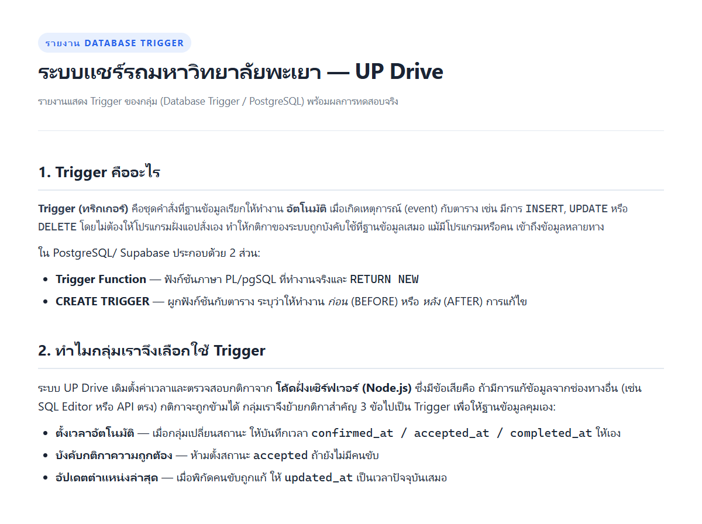
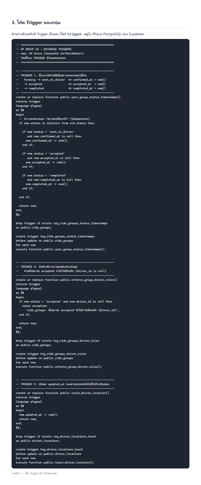
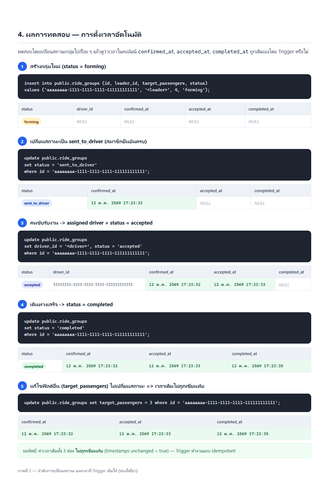
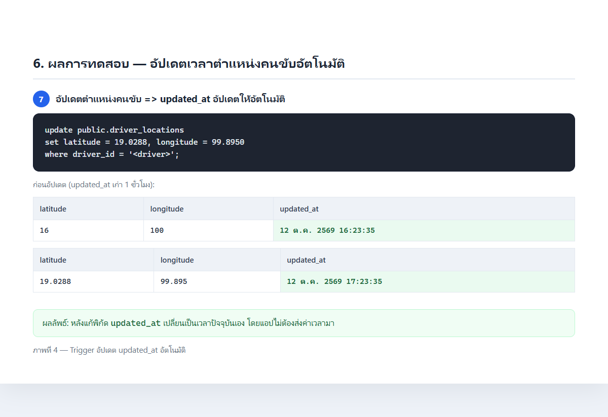
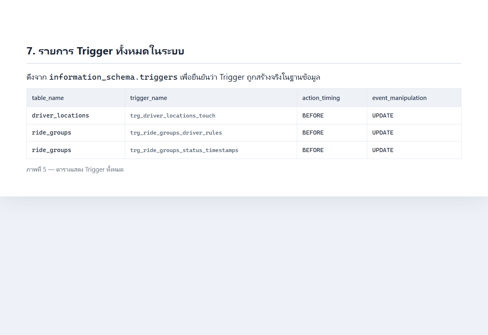

# รายงาน Database Trigger — กลุ่ม UP Drive

**โครงงาน:** ระบบแชร์ค่ารถสำหรับนักศึกษา มหาวิทยาลัยพะเยา (UP Drive)
**ฐานข้อมูล:** PostgreSQL ผ่าน Supabase
**หัวข้อรายงาน:** Trigger ของกลุ่ม (Database Trigger)
**สมาชิกในกลุ่ม:** _______________________

---



> รูปในรายงานนี้เป็น **ผลการรันจริง** ของสคริปต์ Trigger บน PostgreSQL 16
> (จำลองด้วย PGlite/WASM) ด้วย SQL ชุดเดียวกับที่ใช้บน Supabase
> ไฟล์ SQL ทั้งหมดอยู่ในโฟลเดอร์นี้ (`trigger.sql`, `test-trigger.sql`)

---

## 1. Trigger คืออะไร

**Trigger (ทริกเกอร์)** คือชุดคำสั่งที่ฐานข้อมูลเรียกให้ทำงาน **อัตโนมัติ** เมื่อเกิดเหตุการณ์กับตาราง
ได้แก่ `INSERT`, `UPDATE` หรือ `DELETE` โดยไม่ต้องมีคำสั่งจากฝั่งแอปพลิเคชันเลย

ใน PostgreSQL (และ Supabase) Trigger ประกอบด้วย 2 ส่วนที่ทำงานคู่กัน:

| ส่วน | หน้าที่ |
| --- | --- |
| **Trigger Function** | ฟังก์ชันภาษา PL/pgSQL ที่ทำงานจริง เข้าถึงแถวก่อนแก้ (`OLD`) และแถวหลังแก้ (`NEW`) แล้ว `RETURN NEW` |
| **CREATE TRIGGER** | ผูกฟังก์ชันเข้ากับตาราง ระบุ timing ว่า **BEFORE** (ก่อนบันทึก) หรือ **AFTER** (หลังบันทึก) และผูกกับ event ใด |

**Timing ที่สำคัญ**

- `BEFORE` — แก้ค่าใน `NEW` ก่อนบันทึกลงตาราง (ใช้เติมเวลา/ตรวจกติกา) หรือ `RAISE EXCEPTION` เพื่อยกเลิกคำสั่ง
- `AFTER` — ทำงานหลังจากบันทึกแล้ว (ใช้ log หรืออัปเดตตารางอื่น)
- `FOR EACH ROW` — ทำงานทุกแถวที่ถูกแก้

---

## 2. เหตุผลที่กลุ่มเลือกใช้ Trigger

ระบบ UP Drive เดิมทำงานแบบนี้:

- ตอนยืนยันสมาชิกครบ โค้ดฝั่งเซิร์ฟเวอร์ (Node.js) เป็นคนสั่ง `UPDATE ... SET confirmed_at = now()` เอง
- ตอนคนขับรับงาน/เดินทางเสร็จ ก็เป็นโค้ดฝั่งแอปที่ตั้งเวลา `accepted_at` / `completed_at`
- ไม่มีอะไรกันการตั้งสถานะ `accepted` ให้กลุ่มที่ยังไม่มีคนขับ

**ปัญหา:** ถ้ามีการแก้ข้อมูลผ่านช่องทางอื่น (เช่น Supabase SQL Editor, Table Editor หรือ API ตรง)
กติกาเหล่านี้จะถูกข้ามได้ เพราะตรรกะอยู่ที่ตัวแอป ไม่ได้อยู่ที่ฐานข้อมูล

**แนวทางของกลุ่ม:** ย้ายกติกาสำคัญเข้าไปอยู่ที่ฐานข้อมูลด้วย **Trigger 3 ตัว** เพื่อให้ข้อมูลถูกต้องเสมอ
ไม่ว่าจะแก้จากทางไหน (แนวคิด *Data Integrity ที่ฐานข้อมูล*)

---

## 3. Trigger ทั้ง 3 ตัวของกลุ่ม



| # | ชื่อ Trigger | ตาราง | Event / Timing | หน้าที่ |
| --- | --- | --- | --- | --- |
| 1 | `trg_ride_groups_status_timestamps` | `ride_groups` | BEFORE UPDATE (row) | เติม `confirmed_at` / `accepted_at` / `completed_at` ให้อัตโนมัติเมื่อสถานะเปลี่ยน |
| 2 | `trg_ride_groups_driver_rules` | `ride_groups` | BEFORE UPDATE (row) | บล็อก (RAISE EXCEPTION) ถ้าตั้งสถานะ `accepted` แต่ยังไม่มีคนขับ |
| 3 | `trg_driver_locations_touch` | `driver_locations` | BEFORE UPDATE (row) | อัปเดต `updated_at` เป็นเวลาปัจจุบันทุกครั้งที่พิกัดคนขับเปลี่ยน |

โค้ดเต็มอยู่ในไฟล์ [`trigger.sql`](trigger.sql) — สรุป TRIGGER 1 (ตัวหลัก):

```sql
create or replace function public.sync_group_status_timestamps()
returns trigger language plpgsql as $$
begin
  if new.status is distinct from old.status then

    if new.status = 'sent_to_driver' and new.confirmed_at is null then
      new.confirmed_at := now();
    end if;

    if new.status = 'accepted' and new.accepted_at is null then
      new.accepted_at := now();
    end if;

    if new.status = 'completed' and new.completed_at is null then
      new.completed_at := now();
    end if;

  end if;
  return new;
end; $$;

create trigger trg_ride_groups_status_timestamps
before update on public.ride_groups
for each row execute function public.sync_group_status_timestamps();
```

**จุดออกแบบที่สำคัญ**

- ใช้ `is distinct from` เพื่อให้ทำงาน **เฉพาะตอนสถานะเปลี่ยนจริง** ไม่ทำงานตอนแก้ฟิลด์อื่น
- ใช้เงื่อนไข `... is null` เพื่อ **ไม่เขียนทับเวลาเดิม** (idempotent) — กดซ้ำก็ได้ค่าเดิม
- เป็น `BEFORE UPDATE` จึงแก้ค่า `NEW` ได้โดยตรง ก่อนที่ข้อมูลจะถูกบันทึก

---

## 4. ผลการทดสอบ

### 4.1 การตั้งเวลาอัตโนมัติ (TRIGGER 1)

ทดสอบเปลี่ยนสถานะกลุ่มตามลำดับ `forming → sent_to_driver → accepted → completed`
แล้วดูว่าเวลาในคอลัมน์ต่าง ๆ ถูกเติมเองหรือไม่ (ช่องสีเขียวในรูปคือค่าที่ Trigger เติมให้)



**ผลลัพธ์**

| ขั้น | สถานะ | confirmed_at | accepted_at | completed_at |
| --- | --- | --- | --- | --- |
| 1 | forming | NULL | NULL | NULL |
| 2 | sent_to_driver | ✅ เติมให้ | NULL | NULL |
| 3 | accepted | คงเดิม | ✅ เติมให้ | NULL |
| 4 | completed | คงเดิม | คงเดิม | ✅ เติมให้ |
| 5 | (แก้ `target_passengers`) | **ค่าเดิมไม่เปลี่ยน** | **ค่าเดิมไม่เปลี่ยน** | **ค่าเดิมไม่เปลี่ยน** |

> ขั้นที่ 5 ยืนยันว่าการแก้ฟิลด์อื่นไม่ทำให้เวลาเดิมถูกเขียนทับ (timestamps unchanged = **true**)

### 4.2 Trigger บังคับกติกาความถูกต้อง (TRIGGER 2)

เมื่อพยายามตั้งสถานะเป็น `accepted` ให้กลุ่มที่ยังไม่มีคนขับ ฐานข้อมูลปฏิเสธคำสั่งทันที
ข้อมูลไม่ถูกบันทึก (สถานะยังคงเป็น `forming`)


```
ERROR:  ride_groups: ตั้งสถานะ accepted ไม่ได้ถ้าไม่มีคนขับ (driver_id)
```

### 4.3 อัปเดตพิกัดคนขับ (TRIGGER 3)

แก้ `latitude`/`longitude` ของคนขับ แล้ว `updated_at` เปลี่ยนเป็นเวลาปัจจุบันเอง
โดยฝั่งแอปไม่ต้องส่งค่าเวลามา



### 4.4 รายการ Trigger ทั้งหมดในฐานข้อมูล

ยืนยันด้วยการอ่าน `information_schema.triggers`



---

## 5. วิธีทดสอบซ้ำใน Supabase (ทำเองเพื่อเก็บภาพหน้าจอ)

1. เปิด **Supabase → SQL Editor** ของโปรเจกต์
2. เปิดไฟล์ [`test-trigger.sql`](test-trigger.sql) คัดลอกทั้งไฟล์วางแล้วกด **Run**
3. สคริปต์จะสร้าง Trigger แล้วรันทดสอบทีละขั้น (มีคำสั่ง `select` คั่นให้เห็นผลแต่ละขั้น)
4. **แคปหน้าจอ** ผลลัพธ์ในแต่ละข้อ (ตารางผลลัพธ์ + ข้อความ ERROR ของข้อ 5)
5. ตอนจบให้รันคำสั่ง `delete` ในข้อ 7 เพื่อลบข้อมูลทดสอบออก

> หมายเหตุ: สคริปต์ทดสอบใช้ `profile` ที่มีอยู่จริงในระบบ ถ้าไม่มีให้รัน
> `node scripts/seed.js` ก่อน (สร้างบัญชี `passenger@test.com` / `driver@test.com`)

Trigger ทั้งชุดถูกใส่ไว้ในไฟล์ schema จริงของโปรเจกต์แล้ว คือ
[`supabase.sql`](../../supabase.sql) และ [`supabase.test.sql`](../../supabase.test.sql)
หัวข้อ **TRIGGERS** จึงพร้อมใช้งานเมื่อสร้างฐานข้อมูลใหม่

---

## 6. สรุป

- กลุ่มเราเพิ่ม **Database Trigger จำนวน 3 ตัว** ให้ตาราง `ride_groups` และ `driver_locations`
- Trigger ช่วยให้ฐานข้อมูล **เติมเวลาและบังคับกติกาเองอัตโนมัติ** ลดการพึ่งพาโค้ดฝั่งเซิร์ฟเวอร์
  และป้องกันข้อมูลผิดพลาดไม่ว่าจะแก้จากช่องทางใด
- จากผลการทดสอบจริง: เวลาถูกเติมถูกต้องตามสถานะ, ค่าเดิมไม่ถูกเขียนทับ,
  ข้อมูลที่ผิดกติกาถูกบล็อกด้วย ERROR และ `updated_at` ของตำแหน่งคนขับอัปเดตเอง

### ไฟล์ประกอบในโฟลเดอร์นี้

| ไฟล์ | รายละเอียด |
| --- | --- |
| `report.docx` | **ไฟล์ Word พร้อมรูป — อัปโหลดเข้า Google Drive แล้วเปิดเป็น Google Doc ได้เลย** |
| `report.md` | รายงานฉบับนี้ (Markdown) |
| `report.html` | รายงานฉบับเต็มสำหรับเปิดอ่าน/พิมพ์ |
| `trigger.sql` | โค้ด Trigger ทั้ง 3 ตัว |
| `test-trigger.sql` | สคริปต์ทดสอบสำหรับรันใน Supabase SQL Editor |
| `screenshots/` | ภาพประกอบทั้ง 6 ภาพ |
| `fig*.html` | หน้าเว็บต้นทางของแต่ละภาพ |
| `demo/` | สคริปต์ที่ใช้รันทดสอบจริงและสร้างภาพ (PGlite) |
